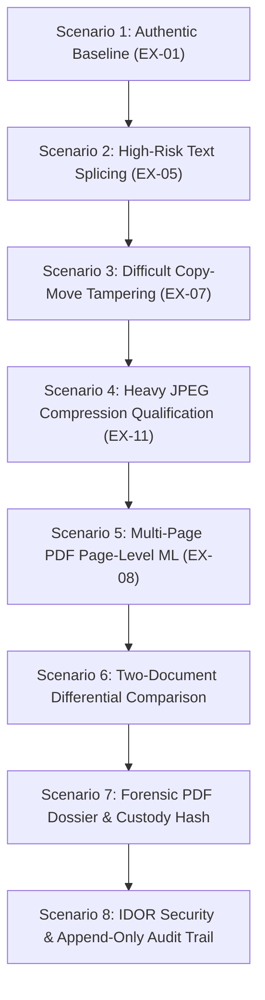

# VisionForensics AI — Demonstration Guide
## Step-by-Step Practical Demonstration Sequence & Presentation Playbook

**Document Reference:** `VF-DEMO-FINAL-20261101`  
**Execution Environment:** Controlled Local Pilot (`https://localhost:8443`)  
**Target Audience:** Academic Evaluators, Forensic Examiners, and Technical Auditors  
**Date:** November 1, 2026

---

## 1. Pre-Demonstration Setup & Environment Readiness

Before initiating the demonstration sequence, confirm that the local pilot environment is running and healthy:

```bash
# 1. Verify Docker containers are active
docker compose -f docker-compose.pilot.yml ps

# Expected output:
# visionforensics-pilot-postgres   Up (healthy)
# visionforensics-pilot-backend    Up (healthy)
# visionforensics-pilot-frontend   Up (healthy)

# 2. In browser, navigate to:
https://localhost:8443
# (Accept internal CA certificate or ensure ca/pilot_ca.crt is installed in OS/browser trust store)
```

### Pre-Configured Demonstration Personas:
- **Analyst A (Intake & Primary Examination):**
  - Email: `pilot_analyst_a@pilot.visionforensics.local`
  - Password: `SmokeTestPassword2026!`
- **Analyst B (Peer Reviewer & Cross-Tenant Auditor):**
  - Email: `pilot_analyst_b@pilot.visionforensics.local`
  - Password: `SmokeTestPassword2026!`
- **Pilot Administrator (System & Custody Auditor):**
  - Email: `pilot_admin@pilot.visionforensics.local`
  - Password: `SmokeTestPassword2026!`

---

## 2. Structured 8-Scenario Demonstration Sequence



---

### Scenario 1: Authentic Document Baseline (`LOW_RISK`)

- **Input Exhibit:** `uploads/phase8_exhibits/exhibit_01_aut_drvlic.tif` (California Driver License scan).
- **Target Endpoint:** `POST /api/v1/upload` followed by `GET /api/v1/documents/{id}/analysis`.
- **Expected Recorded Behavior:**
  - Track 1 Probability: $P_{\text{ML}} = 0.2058$ ($< 0.40$).
  - Predicted Class: `AUTHENTIC`.
  - Unified Risk Tier: **`LOW_RISK`**.
  - Overall Verdict: `LOW_RISK / AUTHENTIC`.
  - Detected Tampering Regions: $0$.
  - Ingestion Latency: $\approx 2.5 - 3.5\text{ seconds}$.
- **What Presenter Should Explain:**
  1. Highlight the non-destructive ingestion: The physical exhibit is stored write-once, and its initial SHA-256 hash is immediately recorded in the PostgreSQL chain-of-custody ledger.
  2. Point out that the 18 physical forensic features (Laplacian variance, blur, ELA maximum difference) all remain within normal authentic tolerances.
  3. Explain that a `LOW_RISK` tier clears the document for automated administrative processing without manual examiner bottleneck.
- **Important Limitations to Disclose:**
  - `LOW_RISK` indicates an absence of detectable digital tampering artifacts; it does not guarantee that the physical card was not a genuine blank stolen from an issuing facility.

---

### Scenario 2: High-Risk Text Splicing Alteration (`HIGH_RISK`)

- **Input Exhibit:** `uploads/phase8_exhibits/exhibit_05_forg_text_drvlic.tif` (Italian Driver License with altered expiration date and demographic text).
- **Target Endpoint:** `POST /api/v1/upload` followed by `GET /api/v1/documents/{id}/analysis`.
- **Expected Recorded Behavior:**
  - Track 1 Probability: $P_{\text{ML}} = 0.9900$ ($> 0.40$).
  - Predicted Class: `FORGED`.
  - Unified Risk Tier: **`HIGH_RISK`**.
  - Overall Verdict: `SUSPICIOUS / HIGH_RISK`.
  - Detected Tampering Regions: Spliced boundary bounding boxes around date fields.
  - Top Contributing Feature: `img_ela_max_difference_mean` (high compression residual disparity).
- **What Presenter Should Explain:**
  1. Demonstrate the interactive overlay canvas: Toggle the ELA heatmap and bounding-box overlays to show where the splicing seams occur.
  2. Explain the physical mechanism: When text characters were pasted into the document, the foreign patch introduced distinct compression history and high-frequency gradient steps, pushing $P_{\text{ML}}$ to $0.9900$.
  3. Show the Explainability Panel: Show how the feature attribution table explicitly identifies `img_ela_max_difference_mean` and `img_laplacian_variance_mean` as the driving factors.
- **Important Limitations to Disclose:**
  - The platform identifies the physical location of the alteration, but human investigator review is required to interpret the semantic meaning (e.g. verifying whether the altered date is expired).

---

### Scenario 3: Difficult Copy-Move Tampering (Track 1 Limits vs. Track 3 Recovery)

- **Input Exhibit:** `uploads/phase8_exhibits/exhibit_07_forg_copymove_id.jpg` (Portuguese National ID card with duplicated demographic text).
- **Target Endpoint:** `GET /api/v1/documents/{id}/analysis`.
- **Expected Recorded Behavior:**
  - Track 1 Raw ML: $P_{\text{ML}} = 0.0910$ ($< 0.40 \implies \text{AUTHENTIC}$, a Track 1 False Negative).
  - Track 3 Visual Evidence: Detected $1$ clone pair (`pairs == 1`, $25$ inliers, cluster confidence $0.85$).
  - Unified Risk Tier: **`SUSPICIOUS`**.
  - Overall Verdict: **`SUSPICIOUS / REVIEW_REQUIRED`**.
  - Track 3 Evidence Items: Source Region and Destination Region bounding boxes rendered on canvas.
- **What Presenter Should Explain:**
  1. **Crucial Technical Concept:** Openly demonstrate the Classical ML Feature Bottleneck. Because the copied demographic text was cloned from within the exact same document, the patch shares identical camera noise and JPEG compression tables, causing Track 1 ELA to remain low ($P_{\text{ML}} = 0.0910$).
  2. Show how Track 3 (Independent Visual Arbiter) operates autonomously: AKAZE keypoint matching identifies 25 geometric inliers between the source text and destination text.
  3. Show that the Synthesis Arbiter elevates the tier from `LOW_RISK` to `SUSPICIOUS / REVIEW_REQUIRED`, ensuring that the document is caught during examiner triage.
  4. Point out that raw Track 1 $P_{\text{ML}}$ was **never overwritten**, maintaining pure auditability.
- **Important Limitations to Disclose:**
  - Classical AKAZE keypoints require sharp corner gradients. Smooth, textureless clones (e.g., duplicated blank background paper) cannot be detected by sparse keypoints and require deep patch embeddings (Phase 10+ roadmap).

---

### Scenario 4: Heavily Compressed JPEG Qualification (Eliminating False Positives)

- **Input Exhibit:** `uploads/phase8_exhibits/exhibit_11_diff_heavy_jpeg.jpg` (Authentic document scan subjected to heavy JPEG compression, $Q = 25$).
- **Target Endpoint:** `GET /api/v1/documents/{id}/analysis`.
- **Expected Recorded Behavior:**
  - Track 1 Raw ML: $P_{\text{ML}} = 0.4129$ ($\ge 0.40 \implies \text{FORGED}$, a raw Track 1 False Positive).
  - DQT Table Header Extraction: Estimated Quality $Q = 25 < 40$.
  - Visual Evidence: $0$ confirmed clone clusters (DCT grid keypoint filter required inliers $\ge 30$).
  - Unified Risk Tier: **`SUSPICIOUS`**.
  - Overall Verdict: **`SUSPICIOUS / COMPRESSION_DEGRADED`**.
  - Advisory Notice: `HEAVY_COMPRESSION_ARTIFACTS` appended to report.
- **What Presenter Should Explain:**
  1. Explain the compression failure mode: At $Q = 25$, coarse $8 \times 8$ DCT block boundaries elevate Laplacian variance ($171.7$), artificially pushing $P_{\text{ML}}$ across the $0.40$ threshold to $0.4129$.
  2. Show the non-destructive DQT inspector: The platform parses the JPEG `0xFFDB` binary header and derives the exact IJG quality factor $Q = 25$ without modifying a single pixel of the exhibit.
  3. Explain the Borderline Qualification Gate: Because $Q < 40$, $P_{\text{ML}} \in [0.40, 0.45]$, and visual clusters are absent, the platform qualifies the document as `COMPRESSION_DEGRADED` rather than accusing an authentic applicant of fraud.
- **Important Limitations to Disclose:**
  - Compression qualification is a defensive filter; if a sophisticated fraudster intentionally compresses a forged document to $Q < 40$, the platform flags it as `SUSPICIOUS` and mandates requesting a higher-resolution scan.

---

### Scenario 5: Multi-Page PDF Deep Forensic Investigation

- **Input Exhibit:** `uploads/phase8_exhibits/exhibit_08_forg_multipage_mixed.pdf` (2-page PDF dossier: Page 0 is authentic, Page 1 contains an altered demographic field).
- **Target Endpoint:** `GET /api/v1/documents/{id}/analysis`.
- **Expected Recorded Behavior:**
  - Document-Level Risk Tier: **`SUSPICIOUS`**.
  - `pages_ml` Breakdown:
    - Page 0: $P_0 = 0.1395$, Predicted Class: `AUTHENTIC`, Tier: `LOW_RISK`.
    - Page 1: $P_1 = 0.3585$, Predicted Class: `AUTHENTIC`, Tier: `SUSPICIOUS`.
  - Multi-Page Threshold: $T_2 = 0.4485$ (Logarithmic threshold for $N = 2$).
- **What Presenter Should Explain:**
  1. Show how Phase 8R resolved the multi-page averaging flaw: In earlier architectures, Page 0 ($0.14$) and Page 1 ($0.36$) were averaged into a single diluted vector ($P \approx 0.18$), masking the alteration.
  2. Navigate through the multi-page viewer: Switch between Page 0 and Page 1 to show independent feature vectors, top contributing features, and localized overlays.
  3. Explain the Empirical Logarithmic Threshold $T_N = \min(0.75, 0.40 + 0.07 \ln N)$: Point out how $T_2 = 0.4485$ prevents multi-page false alarm cascades.
- **Important Limitations to Disclose:**
  - Rendering large PDF documents at high DPI introduces processing latency; the platform applies adaptive resolution scaling to balance feature extraction fidelity against memory limits.

---

### Scenario 6: Two-Document Comparative Analysis

- **Input Exhibits:** Reference Baseline `EX-01` (Authentic California DL) vs. Suspect Exhibit `EX-05` (Italian DL text alteration).
- **Target Endpoint:** `POST /api/v1/comparison`.
- **Expected Recorded Behavior:**
  - SSIM Similarity Score: $0.3078$ (Significantly dropped from $1.0000$).
  - Alignment Status: Geometric feature alignment executed.
  - Differential Regions: $22$ localized discrepancy clusters highlighted.
  - Differential Mask: Visual heatmap showing exact pixel differences.
- **What Presenter Should Explain:**
  1. Demonstrate the Dual-Viewer interface: Display the reference standard and suspect document side-by-side with synchronized pan-and-zoom controls.
  2. Explain the SSIM metric: Shows how Structural Similarity Index drops sharply in areas where text fonts, background micro-printing, or security laminates differ.
  3. Show how this equips examiners to detect template forgery by comparing a suspect document directly against an issuing authority's genuine specimen.
- **Important Limitations to Disclose:**
  - Image alignment requires that both documents share roughly similar aspect ratios and orientation; comparison between completely disparate document types (e.g. passport vs. driver license) falls back to direct resizing.

---

### Scenario 7: Forensic PDF Investigation Report & Cryptographic Hash

- **Input Exhibit:** Any completed investigation (e.g. `EX-05`).
- **Target Endpoint:** `POST /api/v1/reports` followed by `GET /api/v1/reports/{id}/download`.
- **Expected Recorded Behavior:**
  - Generated Report: `VF-REP-20261101-XXXXXXXX`.
  - Report Format: Multi-page structured PDF.
  - Header Verification: Download response includes HTTP header `X-Report-SHA256: <hash>`.
  - Audit Trail: PostgreSQL records `REPORT_GENERATED` and `REPORT_DOWNLOADED`.
- **What Presenter Should Explain:**
  1. Open the downloaded PDF: Review the Cover Page, Executive Summary, Original Exhibit Provenance, ML Metrics, Visual Evidence Overlays, Decision Trace, and Appendix.
  2. Demonstrate Tamper-Evident Integrity: Show that the PDF bytes match the SHA-256 hash recorded in the database custody ledger.
  3. Highlight Terminology Governance: Show that the report uses objective probabilistic language (`HIGH_RISK`, $P_{\text{ML}} = 0.99$) and contains zero definitive legal declarations (`CONFIRMED FORGERY`).
- **Important Limitations to Disclose:**
  - The PDF report reflects platform findings at the moment of generation; if supplementary forensic tests are conducted later, a replacement report version must be generated.

---

### Scenario 8: Cross-Tenant IDOR Security Enforcement & Audit Review

- **Security Setup:** Analyst A owns Exhibit `EX-01` (`c8342634-...`). Analyst B attempts to access it.
- **Target Endpoints:**
  1. Analyst B attempts: `GET /api/v1/documents/c8342634-.../analysis` (using Analyst B's JWT).
  2. Administrator audits: `GET /api/v1/admin/audit-logs` (using Admin JWT).
- **Expected Recorded Behavior:**
  - Analyst B Request: **`HTTP 403 Forbidden`** (`Access forbidden: Document owned by another investigator`).
  - Administrator Audit Log: Immediate `AUTHZ_FAILURE` entry recorded in PostgreSQL with timestamp, Analyst B's user ID, and client IP address.
- **What Presenter Should Explain:**
  1. Emphasize Insecure Direct Object Reference (IDOR) defense: Shows that knowing a UUID does not allow an unauthorized analyst or adversary to access confidential identity documents.
  2. Log in as Pilot Administrator and open the Audit Log viewer: Show the immutable append-only record of the blocked attempt.
  3. Conclude by demonstrating physical exhibit tamper protection: If an exhibit's disk bytes are altered, the system issues `HTTP 409 Conflict` and triggers a `TAMPERING_ALARM`.
- **Important Limitations to Disclose:**
  - Security audit logs are persisted in PostgreSQL; in a full enterprise deployment, logs should also be streamed to a write-once SIEM (e.g. Splunk or Elasticsearch) for long-term archiving.
