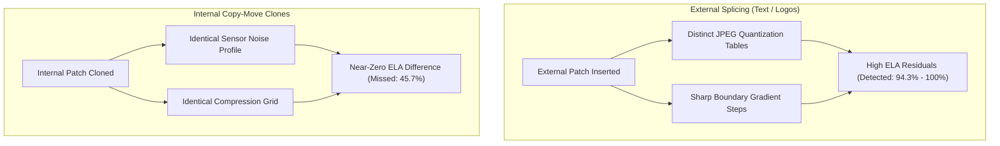
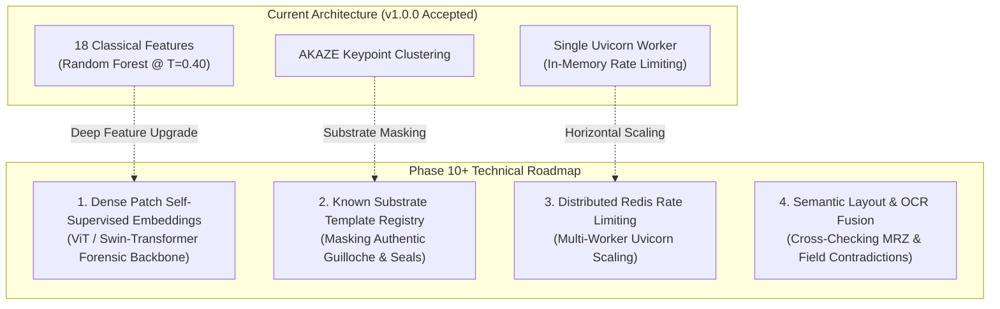

# VisionForensics AI — Final Limitations & Future Scope
## Critical Analysis of Algorithmic Boundaries, Dataset Constraints, and Technical Roadmap

**Document Reference:** `VF-LIMIT-FINAL-20261101`  
**System Status:** **ACCEPTED WITH GOVERNANCE BOUNDARIES**  
**Date:** November 1, 2026

---

## 1. Algorithmic & Classical Machine Learning Limitations

### 1.1 The Classical Feature Ceiling on Smooth Copy-Move Clones
The most prominent physical limitation of classical feature engineering is the detection of **internal copy-move duplications on smooth, untextured substrates**:
- **Empirical Observation:** On the Phase 4 locked held-out benchmark, the frozen Random Forest detected only **54.29% of copy-move alterations** (19 / 35), accounting for **16 out of the 18 total false negatives** (88.9%).
- **Physical Root Cause:**
  - Standard splicing operations (such as text field alteration or logo insertion) transplant pixels from external sources, introducing distinct compression quantization histories and high-frequency edge seams that heavily trigger Error Level Analysis (`img_ela_max_difference_mean`, 38.2% feature importance) and Laplacian variance (`img_laplacian_variance_mean`, 12.4% importance).
  - In copy-move forgery, the cloned patch originates from within the exact same image. The copied patch shares identical camera sensor noise, identical white balance, and identical JPEG compression tables. Therefore, global ELA residuals remain indistinguishable from authentic baseline levels.
  - When the copied patch is taken from a smooth, low-contrast area (such as blank paper or solid plastic laminates), AKAZE keypoint detectors cannot extract sufficient unique gradient features to form candidate matches, allowing smooth clones to evade classical feature extraction.

---

### 1.2 Substrate Repetition & False Alarm Trade-offs
Identity documents are intentionally designed with repetitive graphical security elements (e.g. repetitive guilloche wavy linework, microprint borders, dual official agency emblems, and repeated state watermarks):
- **Empirical Impact:** In Track 3 (Visual Evidence Arbiter), evaluating geometric keypoint clustering across raw video captures identified genuine feature matches across these identical authentic emblems:
  - On authentic Ukrainian ID cards (`44_ukr_id_`), the repeated state trident emblems matched across the card face.
  - On authentic Uruguayan passports (`46_ury_passport_`), the official sun-face crest produced over 40 inlier matches.
- **Consequence:** These repetitive authentic elements triggered Track 3's high-risk multi-cluster gate, elevating 10 authentic captures to `HIGH_RISK` and increasing platform false positive rate from **10.71% to 17.86%** on raw video captures.
- **Operational Reality:** This illustrates the classical forensic trade-off: elevating sensitivity to recover subtle cloned text and stamps inherently increases sensitivity to repetitive authentic substrate graphics.

---

### 1.3 High-Frequency Loss under Severe Re-compression & Blurring
Classical physical forensics relies on high-frequency pixel gradients:
- If a document is scanned at low resolution ($< 150 \text{ DPI}$), aggressively downscaled, or subjected to repeated lossy re-compression ($Q < 30$), fine edge seams and noise variance are attenuated.
- While the platform's non-destructive JPEG quality estimator successfully qualifies severe compression ($Q < 40$) to prevent false accusations, it cannot reconstruct missing physical evidence. Highly degraded documents must be routed for physical rescan.

---

## 2. Dataset Constraints & Generalization Boundaries

### 2.1 Small Physical Specimen Sample Size ($K = 7$)
The Phase 4 held-out benchmark consists of 280 images originating from **seven physical document specimens** from the MIDV-500 dataset:
- While resampled cluster bootstrap confidence intervals confirmed that performance is not driven by an outlier specimen, evaluating only seven physical documents means that conclusions cannot be generalized to the thousands of distinct identity document formats issued globally.
- MIDV-500 focuses on identity cards, driving licenses, and passports. The platform has not been evaluated on non-identity administrative records, such as multi-column corporate contracts, paper invoices, utility bills, or handwritten receipts.

### 2.2 Video Frame Capture Correlation
The 40 images per specimen in MIDV-500 represent sequential video frames under varying illumination conditions (casual ambient, direct table light, partial shadows, keyboard glare):
- Lighting artifacts (specular reflections, harsh shadows) alter local Laplacian variance and ELA noise, introducing variance into single-frame predictions.
- Single-frame inference on a casual mobile capture exhibits higher false-positive rates than batch-averaged evaluations.

---

## 3. Operational & Legal Boundaries

VisionForensics AI is explicitly engineered as an **investigative screening and triage tool for trained forensic document examiners**, not an autonomous judicial decision-maker:
1. **No Legal Admissibility Claims:** Outputs generated by the platform (such as risk tiers and probability scores) do not constitute legally binding declarations of forgery under judicial evidence rules (e.g., Daubert or Frye standards in US jurisprudence).
2. **Proscription of Definitive Terminology:** The platform strictly prohibits labeling any document as `CONFIRMED FORGERY`. Documents are categorized into probabilistic risk tiers (`LOW_RISK`, `SUSPICIOUS`, `HIGH_RISK`) accompanied by visual anomaly overlays.
3. **Mandatory Human-in-the-Loop:** All documents classified as `SUSPICIOUS` or `HIGH_RISK` require manual examination by an accredited forensic investigator using the platform's Two-Document Comparison tool and raw exhibit inspector.

---

## 4. Phase 10+ Technical Roadmap & Future Scope

To surpass the classical feature ceiling and scale beyond single-instance pilot constraints, the following future engineering phases are recommended:

### 1. Dense Patch Vision Backbones for Textureless Clone Detection:
- Replace sparse AKAZE keypoint matching with dense patch self-supervised embeddings (e.g. Vision Transformer / Swin-Transformer forensic backbones or DenseNet contrastive feature maps).
- Dense spatial correlation maps compare patch embeddings across the entire document plane, enabling the detection of smooth copy-move duplications that lack sharp gradient corners.

### 2. Document Substrate Template Registry:
- Establish a digital registry of known official document templates (e.g., standard layout masks for Ukrainian ID cards, Uruguayan passports, and California driver licenses).
- The template registry masks known authentic repetitive graphics (state seals, guilloche borders, security microprint) from keypoint matching, eliminating substrate-induced false alarms on authentic documents while preserving high sensitivity to forged alterations.

### 3. Distributed Redis Rate Limiting & Horizontal Scaling:
- Replace the in-memory sliding window rate limiter with a centralized Redis backend.
- Enables scaling the FastAPI backend across multiple Uvicorn workers and multi-instance container clusters without synchronization drift.

### 4. End-to-End Semantic OCR & Layout Consistency:
- Integrate deep layout and text verification (e.g., Donut or LayoutLMv3) to automatically cross-check semantic demographic data:
  - Validating Machine-Readable Zone (MRZ) checksums against visual text fields.
  - Detecting font typography mismatches and baseline misalignment.
  - Flagging logical contradictions (such as expiry dates occurring prior to issue dates).
