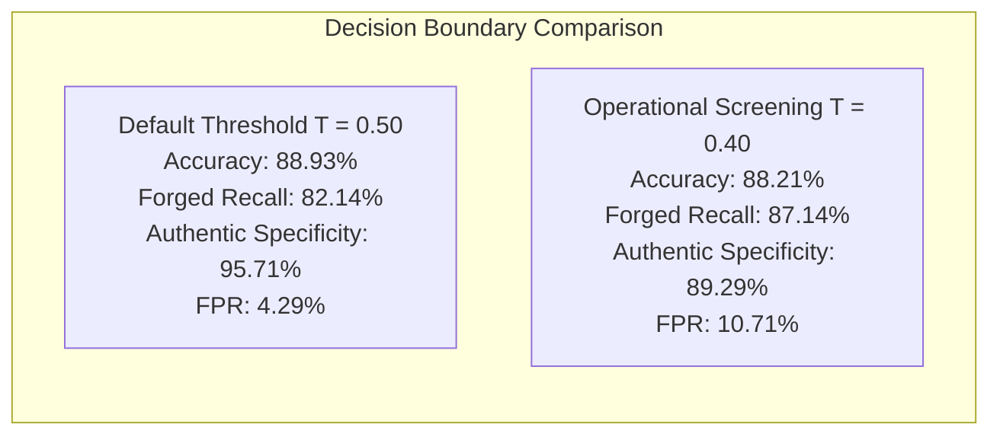
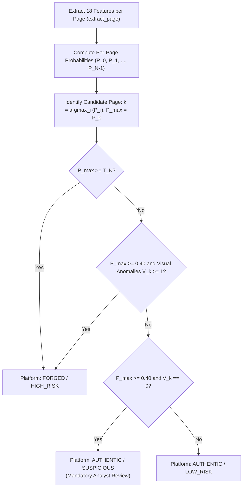

# VisionForensics AI — Final Machine Learning Methodology
## Statistical Forensics, Feature Engineering, and Multi-Track Decision Synthesis

**Document Reference:** `VF-ML-FINAL-20261101`  
**Model Architecture:** Frozen Random Forest Classifier ($100$ Estimators)  
**Model Checksum (SHA-256):** `f274d4a93661ce8c5fd95f41a43e629edac41ab16d771355e7decacf0040e280`  
**Active Schema Checksum (SHA-256):** `eaef52167d829396728b78af848acae3ef62097538cb8433de29aa635c45c3dc`  
**Date:** November 1, 2026

---

## 1. Problem Formulation: Physical Document Forensics

Digital document forgery detection is formulated as a statistical anomaly detection and pattern recognition task over physical and digital capture artifacts. When an authentic document is fabricated, captured, or scanned, the imaging pipeline imposes consistent physical characteristics:
1. **Sensor Noise Consistency:** Thermal and shot noise from the camera sensor follow a stationary distribution across the capture plane.
2. **Optical Defocus & Blur:** Lens blur and chromatic aberration vary smoothly from image center to periphery.
3. **Compression Uniformity:** Lossy compression algorithms (JPEG/DCT) quantize $8 \times 8$ pixel blocks uniformly according to a global quantization table.

When a document undergoes digital manipulation (splicing text, replacing portraits, inserting official emblems, or copying stamps):
- Foreign image patches introduce **discontinuous compression error rates** (detectable via Error Level Analysis).
- Spliced boundaries disrupt local **Laplacian gradient variance** and high-frequency edge densities.
- Duplicated patches create **correlated feature descriptor matches** across disparate spatial coordinates.

VisionForensics AI extracts an auditable 18-dimensional feature vector $\mathbf{x} \in \mathbb{R}^{18}$ capturing these physical dimensions and evaluates them through a frozen supervised classifier coupled with geometric visual arbiters.

---

## 2. The 18 Active Numerical Features Schema

The platform enforces a frozen, immutable 18-feature schema (`active_feature_schema.json`). Every feature is mathematically defined, physically interpretable, and audited for zero data leakage:

| Index | Feature Name | Extraction Domain | Mathematical / Physical Formulation | Feature Importance (RF) |
| :---: | :--- | :--- | :--- | :---: |
| `0` | `img_width` | Spatial Geometry | Native pixel width $W$ of the document image. | 1.8% |
| `1` | `img_height` | Spatial Geometry | Native pixel height $H$ of the document image. | 1.9% |
| `2` | `img_aspect_ratio` | Spatial Geometry | Ratio of width to height: $AR = W / H$. | 2.1% |
| `3` | `img_laplacian_variance_mean` | Sharpness / Texture | Mean variance of the discrete Laplacian operator: $\sigma^2(\nabla^2 I)$. Captures edge sharpness and splicing seams. | **12.4%** |
| `4` | `img_blur_severity_mean` | Optics / Focus | Fraction of image tiles with Laplacian variance below blur threshold. Detects localized smoothing or feathering. | 6.8% |
| `5` | `img_noise_sigma_mean` | Sensor Residuals | Mean standard deviation of high-frequency noise extracted via median wavelets. | 5.2% |
| `6` | `img_edge_density_mean` | Edge Discontinuity | Density of Canny edge pixels normalized by image area: $N_{\text{edge}} / (W \cdot H)$. | 4.3% |
| `7` | `img_illumination_std_mean` | Radiometry | Standard deviation of grayscale pixel intensities across luminance channel. | 3.9% |
| `8` | `img_ela_region_count_mean` | Compression Error | Count of connected anomalous error regions exceeding 95th percentile ELA threshold. | 8.7% |
| `9` | `img_ela_max_difference_mean` | Compression Error | Peak difference between original pixel intensity and re-saved JPEG (quality 95) intensity: $\max \|I - I_{95}\|$. Primary splicing discriminator. | **38.2%** |
| `10` | `img_entropy_score_mean` | Information Theory | Shannon entropy of pixel intensity histogram: $H(I) = -\sum p(i) \log_2 p(i)$. | 4.1% |
| `11` | `cm_keypoint_count_akaze` | Keypoint Density | Total number of Accelerated-KAZE (AKAZE) feature keypoints detected in non-linear scale space. | 1.5% |
| `12` | `cm_descriptor_matches` | Geometric Feature | Count of k-NN descriptor matches passing the Lowe ratio test ($r < 0.75$). | 2.2% |
| `13` | `cm_inlier_matches` | RANSAC Consensus | Count of geometric inliers supporting spatial affine transformations between matched clusters. | 3.8% |
| `14` | `cm_average_region_size` | Geometry | Mean pixel area of identified duplicate bounding boxes. | 1.4% |
| `15` | `cm_duplicate_pair_count` | Cluster Topology | Number of distinct paired duplicate clusters identified via spatial DBSCAN clustering. | 2.7% |
| `16` | `cm_confidence` | Consensus Metric | Confidence score derived from inlier ratio and spatial cluster separation distance. | 2.9% |
| `17` | `cm_inlier_ratio` | Consensus Metric | Ratio of geometric inliers to total candidate descriptor matches: $N_{\text{inliers}} / N_{\text{matches}}$. | 4.2% |

---

## 3. Frozen Random Forest Architecture & Training Provenance

- **Classifier Architecture:** Supervised Random Forest Classifier (`sklearn.ensemble.RandomForestClassifier`).
- **Hyperparameter Specifications:**
  - Estimators: $100$ decision trees.
  - Max Depth: None (full tree expansion until leaf purity or minimum split).
  - Min Samples Split: $2$.
  - Min Samples Leaf: $1$.
  - Criterion: Gini Impurity.
  - Class Weighting: `balanced` (inversely proportional to class frequencies).
  - Random State: $42$ (reproducible deterministic training).
- **Training Corpus Provenance:**
  Trained during Phase 3 on the partitioned MIDV-500 training split ($N = 840$ images across 21 physical specimens), cross-validated on the Phase 3 validation split ($N = 280$ images across 7 physical specimens).
- **Frozen Status:** The model binary artifact was compiled on October 31, 2026, and cryptographically locked with SHA-256 checksum `f274d4a9...`. It has undergone zero retraining, parameter tuning, or weight modification.

---

## 4. Operational Threshold Strategy: Default $T=0.50$ vs. Screening $T=0.40$

During model development, two threshold regimes were established:

### Forensic Rationale for Operational Screening Threshold $T = 0.40$:
1. **Asymmetry of Forensic Risk:** In document security, the operational cost of admitting a fraudulent document (a False Negative) is substantially higher than the administrative cost of routing an authentic document for human review (a False Positive).
2. **Empirical Gain:** Lowering the operational decision threshold from $T = 0.50$ to $T = 0.40$ on the locked held-out benchmark increased Forged Recall from **82.14% to 87.14%** (detecting 7 additional forgeries), while maintaining Authentic Specificity at a robust **89.29%**.

---

## 5. Multi-Page Logarithmic Significance Gating (REM-02)

On multi-page PDF documents, evaluating each page independently avoids feature-averaging dilution. However, simply taking the maximum probability across $N$ pages ($\max_i P_i$) causes an extreme-value sampling distribution that monotonically inflates false alarms ($1 - (1 - \alpha)^N$).

### The Logarithmic Threshold Formulation:
To govern multi-page aggregation without false-alarm cascading, the platform evaluates:
$$T_N = \min\left(0.75, \; 0.40 + 0.07 \cdot \ln N\right)$$

- **Candidate Selection:** Identifies the most suspicious page $k = \arg\max_i P_i$, setting $P_{\max} = P_k$.
- **Corroborated Routing:**
  - If $P_{\max} \ge T_N$: Document ML class is set to `FORGED` and risk tier to `HIGH_RISK`.
  - If $P_{\max} \ge 0.40$ and page $k$ contains corroborated visual anomalies ($V_k \ge 1$ detected bounding boxes): Set to `FORGED` / `HIGH_RISK`.
  - If $P_{\max} \ge 0.40$ but $V_k == 0$ (unsupported statistical elevation): Set to `AUTHENTIC` / `SUSPICIOUS`, routing for visual verification without issuing a false alarm.

---

## 6. Track 3 Geometric Visual Anomaly & Copy-Move Arbiter (REM-03)

### The Classical Model Copy-Move Bottleneck:
In the Random Forest feature importance hierarchy, the primary discriminator is `img_ela_max_difference_mean` (38.2% weight). Because copy-move clones duplicate patches from within the exact same document, the source and destination patches share identical camera sensor noise, white balance, and JPEG compression grids. Therefore, ELA residuals remain near authentic baselines, causing Random Forest alone to detect only 54.3% of copy-move alterations.

### Track 3 Keypoint Matching & Spatial Clustering:
To resolve this limitation, [`CopyMoveRegionAnalyzer`](file:///d:/Forgery%20Detection%20ML/backend/app/services/forensics/copy_move_region_analyzer.py) executes as an autonomous arbiter:
1. **Non-Linear Scale Space Detection:** AKAZE detects multiscale feature keypoints across non-linear diffusion filtering spaces.
2. **Descriptor Matching:** Accelerated-KAZE binary descriptors are matched using k-nearest neighbors ($k=2$). Matches are filtered via Lowe's ratio test:
   $$\frac{d(\mathbf{f}_1, \mathbf{f}_{2,\text{first}})}{d(\mathbf{f}_1, \mathbf{f}_{2,\text{second}})} < 0.75$$
3. **Spatial Consensus & RANSAC:** Matched keypoints undergo spatial clustering (DBSCAN, $\epsilon = 50\text{px}$, $\text{min\_samples} = 5$). Affine transformation consensus filters out random matches.
4. **False Positive Guard (Substrate Protection):**
   - Repetitive official graphics (guilloche borders, state seals, bank watermarks) naturally produce matching keypoints.
   - To guard authentic documents, Track 3 requires:
     - Minimum inliers: $\ge 15$
     - Cluster confidence: $\ge 0.80$
     - Multi-Cluster Discrimination: Single clone pairs (`cm_pairs == 1`) assign `SUSPICIOUS`, whereas multiple clone clusters (`cm_pairs >= 2` or `inliers >= 40`) elevate to `HIGH_RISK`.

---

## 7. Non-Destructive JPEG Quality Factor Derivation (REM-04)

Lossy JPEG compression quantizes frequency coefficients in $8 \times 8$ blocks. At low quality ($Q < 40$), the coarse quantization grid creates sharp $8 \times 8$ block boundary steps that elevate high-frequency Laplacian variance and generate spurious keypoint matches across identical quantization cells.

### Direct DQT Parsing Implementation:
Rather than modifying or deblocking exhibit pixels, [`jpeg_quality_estimator.py`](file:///d:/Forgery%20Detection%20ML/backend/app/services/forensics/jpeg_quality_estimator.py) non-destructively inspects the binary JPEG header stream:
1. Locates the Define Quantization Table marker (`0xFFDB`).
2. Extracts the 64-element luminance quantization table $T_L$.
3. Derives the scaling factor $S$ against the standard Independent JPEG Group (IJG) reference luminance matrix $T_{\text{std}}$:
   $$S = \frac{100}{64} \sum_{i=0}^{63} \frac{T_L(i)}{T_{\text{std}}(i)}$$
4. Computes the exact IJG Quality Factor $Q \in [1, 100]$:
   $$Q = \begin{cases} 
   \text{round}\left(\frac{5000}{S}\right), & \text{if } S > 100 \\
   \text{round}\left(200 - 2S\right), & \text{if } S \le 100 
   \end{cases}$$
5. **Borderline Gate:** If $Q < 40$ and $P_{\text{ML}} \in [0.40, 0.45]$ without visual confirmation, the synthesis arbiter qualifies the verdict to `SUSPICIOUS / COMPRESSION_DEGRADED` and Track 1 class to `AUTHENTIC`, permanently appending the `HEAVY_COMPRESSION_ARTIFACTS` advisory notice.

---

## 8. Calibration & Statistical Reliability

On the locked Phase 4 held-out benchmark ($N = 280$), the frozen Random Forest demonstrated exceptional calibration:
- **Brier Score:** **0.0829** (substantially outperforming the reference Logistic Regression baseline of 0.1018).
- **ROC-AUC:** **0.9473** (confirming superior class-ranking capability).
- **PR-AUC (Average Precision):** **0.9607** (demonstrating high precision across varying recall operating points).
