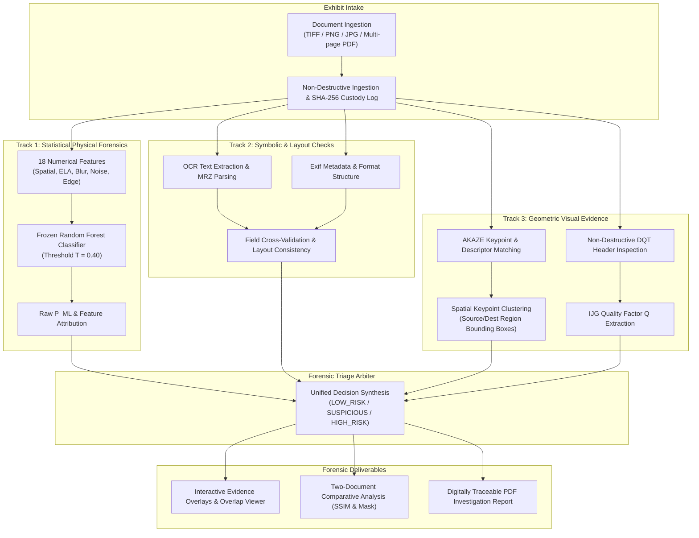

# VisionForensics AI — Final Project Overview
## Intelligent Multi-Track Document Forgery Detection & Forensic Analysis Platform

**Project Reference:** VisionForensics AI  
**Academic / Operational Milestone:** Phase 10 (Final Project Closure & Demonstration Preparation)  
**System Classification:** Forensic Document Tampering Screening & Triage Platform  
**Target Environment:** Controlled Pilot (`127.0.0.1:8443` HTTPS)  
**Date:** November 1, 2026

---

## 1. Executive Summary & Mission

In high-consequence administrative, financial, and border-control workflows, identity document fraud poses an acute operational challenge. Modern image editing tools allow malicious actors to perform sophisticated text alterations, signature transplants, logo insertions, and copy-move duplications with visual plausibility that deceives human screeners.

Existing automated verification tools often exhibit critical failure modes:
1. **Opaque Black-Box Models:** End-to-end deep learning classifiers produce scalar probabilities without localized evidence, rendering them legally and forensically uninterpretable.
2. **The Copy-Move Blindspot:** Splicing detectors relying exclusively on global Error Level Analysis (ELA) or noise variance fail when content is cloned from within the same document, as both regions share identical sensor noise and compression history.
3. **Compression Artifact Vulnerability:** Routine lossy JPEG re-compression introduces high-frequency block grid artifacts that standard ML classifiers misinterpret as tampering boundaries, creating unacceptable false positive rates on authentic scans.
4. **Multi-Page Dilution:** Averaging feature vectors across multi-page PDF documents dilutes localized alterations, allowing single-page forgeries to escape detection.

**VisionForensics AI** resolves these fundamental challenges through a **Multi-Track Forensic Architecture**. The platform does not rely on a single monolithic score. Instead, it decouples statistical likelihood estimation, symbolic cross-consistency checks, and geometric keypoint matching into three independent, auditable evidence tracks, arbitrated by an operational triage engine with cryptographic chain-of-custody tracking.

---

## 2. The Three Independent Evidence Tracks

### Track 1: Classical Machine Learning Forensics
- **Objective:** Quantify statistical deviations in physical document surface characteristics.
- **Model:** Frozen Random Forest Classifier ($100$ estimators, balanced class weights, scikit-learn 1.3.2).
- **Features:** Exact 18-feature schema capturing image dimensions, aspect ratio, Laplacian variance (sharpness), blur severity, noise sigma, edge density, illumination standard deviation, ELA maximum and regional differences, entropy, and keypoint statistics.
- **Invariance Rule:** The operational threshold $T = 0.40$ and model weights are strictly frozen. The raw probability $P_{\text{ML}}$ is permanently recorded and never overridden by symbolic or visual qualifications.

### Track 2: Symbolic OCR, Layout, and Metadata Consistency
- **Objective:** Verify syntactic and structural coherence of textual demographic information.
- **Components:** Optical character recognition (OCR) field extraction, machine-readable zone (MRZ) checksum validation, font bounding-box alignment, and EXIF creation timestamp auditing.
- **Role:** Identifies logical discrepancies (such as date of birth contradictions or missing issuing stamps) that do not require physical pixel alterations.

### Track 3: Geometric Visual Anomaly & Copy-Move Evidence
- **Objective:** Detect and isolate identical graphic structures duplicated across the document.
- **Algorithm:** Accelerated-KAZE (AKAZE) non-linear scale space feature detection, k-nearest neighbor (k-NN) ratio test descriptor matching ($r < 0.75$), and DBSCAN spatial region clustering.
- **Independence:** Functions as an autonomous evidence path capable of identifying cloned signatures, stamps, faces, and text fields even when Track 1 statistical features remain near authentic baselines.

---

## 3. Core Architectural Philosophy: Forensic Triage vs. Joint Probability

A central principle of VisionForensics AI is that **the platform's unified decision is an operational forensic triage result, NOT a mathematically calibrated joint probability distribution**.

### Why Joint Probability Fusion is Statistically Inappropriate:
In classical probabilistic fusion, combining ML output ($P_{\text{ML}}$) and visual keypoint evidence ($P_{\text{visual}}$) into a single scalar value via Bayes' rule requires assuming conditional independence given the class label:
$$P(\text{Forged} \mid E_1, E_2) \propto P(E_1 \mid \text{Forged}) \cdot P(E_2 \mid \text{Forged})$$
In document forensics, this assumption is fundamentally violated:
1. Spliced text alters both local ELA compression and spatial edge sharpness (highly correlated).
2. Cloned seals share identical background textures and camera sensor noise.
3. Forcing heterogeneous evidence into a single fused probability creates "pseudo-certainty" that obscures the physical cause of suspicion and misleads legal triers of fact.

### The Forensic Triage Paradigm:
Instead of computing an artificial joint probability, VisionForensics AI implements a deterministic **Synthesis Arbiter**:
- **`LOW_RISK`:** Track 1 $P_{\text{ML}} < 0.30$, zero symbolic contradictions, and zero visual clone clusters. Cleared for automated intake.
- **`SUSPICIOUS`:** Borderline statistical score ($P_{\text{ML}} \in [0.30, 0.60)$), single isolated keypoint match (`cm_pairs == 1`), or severe JPEG compression ($Q < 40$). Document is flagged for mandatory manual verification.
- **`HIGH_RISK`:** Statistical evidence ($P_{\text{ML}} \ge 0.60$), multiple corroborated clone clusters (`cm_pairs >= 2`), or visual anomaly corroborated with $P_{\text{ML}} \ge 0.40$. Escalated for formal forensic investigation.

This approach guarantees that every alert is directly traceable to physical evidence (e.g. "Cloned Region Pair Detected at $(x_1, y_1)$ and $(x_2, y_2)$ with 27 inliers") rather than an uninterpretable decimal score.

---

## 4. Chronological Project Milestones

| Phase / Milestone | Period | Primary Objectives & Achievements | Acceptance Status |
| :--- | :---: | :--- | :---: |
| **Phase 1: Ingestion & Baseline Pipeline** | Oct 2026 | Document intake, preprocessing, multi-format conversion, and initial schema. | ACCEPTED |
| **Phase 2: Dataset Engineering & Features** | Oct 2026 | MIDV-500 partition (Train/Val/Test), 18-feature engineering, extraction pipeline. | ACCEPTED |
| **Phase 3: Baseline Model Training** | Oct 2026 | Random Forest and Logistic Regression training, 5-fold CV, calibration, threshold tuning. | ACCEPTED |
| **Phase 4: Held-Out Test Evaluation** | Oct 2026 | Unsealing quarantined test set ($N=280$, 7 specimens), frozen inference, bootstrap CIs. | ACCEPTED |
| **Phase 5: Full Backend Architecture** | Oct 2026 | 11-stage async pipeline, PostgreSQL schema, exhibit custody logging, Alembic migrations. | ACCEPTED |
| **Phase 6: Frontend Forensic Workspace** | Oct 2026 | React 18 SPA, Tailwind CSS, interactive overlay canvas, dual-document comparator. | ACCEPTED |
| **Phase 7: Integrated Platform & Security** | Oct 2026 | Argon2id auth, JWT rotation, IDOR protections, forensic PDF generator, audit logging. | ACCEPTED |
| **Phase 8: Controlled Local Pilot** | Nov 2026 | Docker pilot environment, dedicated internal CA, 10/10 smoke tests, 12 pilot exhibits. | ACCEPTED |
| **Phase 8R: Forensic Remediation** | Nov 2026 | Per-page ML (REM-01), multi-page gating (REM-02), Track 3 arbiter (REM-03), JPEG qualification (REM-04). | ACCEPTED |
| **Phase 9: Locked Benchmark Evaluation** | Nov 2026 | Re-evaluation on Phase 4 benchmark ($N=280$), specimen-level analysis, acceptance audit. | ACCEPTED |
| **Phase 10: Project Closure & Handover** | Nov 2026 | Codebase freeze manifest, technical documentation, demo scripts, viva preparation. | **COMPLETED** |

---

## 5. Summary of Accepted Performance & Limitations

### Verified Operational Capabilities:
- **Held-Out Test Accuracy:** **88.21%** across 280 test frames at $T = 0.40$.
- **Detection of Splicing, Logos, and Signatures:** **94.3% to 100.0% recall** across unseen document categories.
- **Physical Specimen Reliability:** Complete separation of authentic vs. forged mean probabilities across all seven physical documents.
- **Throughput:** Sub-millisecond model inference latency (~0.087 ms / frame) and end-to-end ingestion under 3.5 seconds.
- **Traceability:** Full cryptographic audit trail preserving immutable SHA-256 exhibit hashes and tamper alerts.

### Operational Boundaries:
- **Classical Feature Ceiling:** Copy-move recall on smooth, textureless surfaces plateaus at ~54%–57% due to classical keypoint matching limits.
- **Substrate Repetition:** High-density repetitive official emblems (e.g. Ukrainian trident watermarks) trigger visual keypoint matches, requiring manual confirmation for `SUSPICIOUS` alerts.
- **Decision Scope:** The platform outputs risk tiers and anomaly evidence for human investigators; it does not issue definitive legal declarations.
