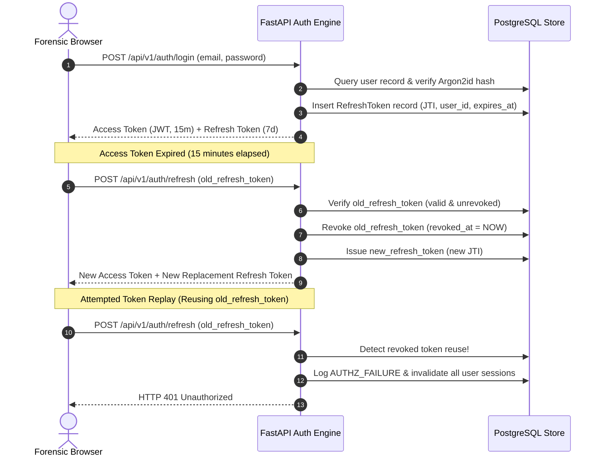
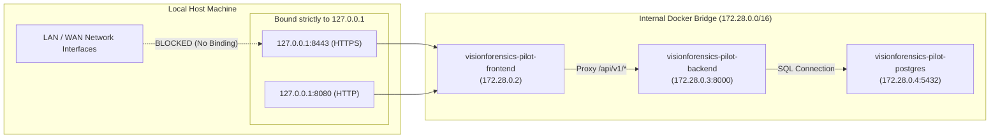

# VisionForensics AI — Final Security & Deployment Guide
## Forensic Security Architecture, Network Hardening, and Deployment Runbook

**Document Reference:** `VF-SEC-FINAL-20261101`  
**Security Classification:** Forensic Enterprise Standard  
**Deployment Target:** Restricted Single-Instance Localhost Grid (`127.0.0.1:8443`)  
**Date:** November 1, 2026

---

## 1. Forensic Threat Model & Security Principles

Digital document forensics platforms operate in an adversarial threat landscape where malicious actors may attempt to:
1. **Tamper with Stored Evidence:** Modify uploaded exhibits on disk to invalidate investigations or conceal tampering seams.
2. **Exfiltrate Confidential Identity Documents:** Exploit Insecure Direct Object References (IDOR) to access sensitive identity cards, passports, and driver licenses belonging to other cases.
3. **Impersonate Forensic Examiners:** Forge session credentials or execute token replay attacks.
4. **Manipulate Client IP & Audit Records:** Inject spoofed proxy headers (`X-Forwarded-For`) to falsify digital chain-of-custody ledgers.

VisionForensics AI implements **Defense-in-Depth** anchored on five core security principles:
- **Zero-Trust Network Perimeter:** All traffic is confined to localhost with dedicated internal CA termination.
- **Cryptographic Immutability:** Exhibits are hashed with SHA-256 upon ingestion and actively audited on every access.
- **Tenant Isolation:** Cross-analyst boundaries are cryptographically and logically enforced at the ORM layer.
- **Privilege Minimization:** Backend processes and database connections execute under restricted, non-root system identities.
- **Audit Completeness:** All forensic actions are logged to append-only database ledgers that cannot be modified via standard APIs.

---

## 2. Authentication, Session Security & RBAC

### 2.1 Password Hashing with Argon2id
User passwords are encrypted using **Argon2id** (the winner of the Password Hashing Competition), configured with high memory and computational hardness:
- Time Cost: $3$ iterations.
- Memory Cost: $65,536 \text{ KiB}$ ($64 \text{ MB}$).
- Parallelism: $4$ lanes.
- Rainbow table defense: Unique cryptographically random 16-byte salt per hash.

### 2.2 Dual-Token Architecture with Single-Use Rotation


- **Short-Lived Access Tokens:** Signed JWTs using HMAC-SHA256 (`HS256`), containing `sub` (user_id), `role`, `email`, and `exp` ($15 \text{ minutes}$).
- **Single-Use Refresh Token Rotation:** Refresh tokens are persisted in PostgreSQL. When exchanged, the presented token is immediately revoked, and a replacement pair is issued. If an already-revoked refresh token is presented, the system detects a token replay attack and terminates all active sessions for that user account.

### 2.3 Cross-Tenant Insecure Direct Object Reference (IDOR) Protection
All document, analysis, comparison, and report retrieval endpoints enforce ownership validation against the authenticated JWT context:
```python
# Enforced in app/services/document_service.py
if document.owner_id != current_user.id and current_user.role != UserRole.ADMIN:
    audit_service.log_security_event(
        event_type="AUTHZ_FAILURE",
        user_id=current_user.id,
        description=f"Unauthorized access attempt to document {document_id}"
    )
    raise HTTPException(status_code=403, detail="Access forbidden: Document owned by another investigator.")
```

---

## 3. Cryptographic Chain-of-Custody & Tamper Alarms

To satisfy legal chain-of-custody standards for digital evidence:

### 3.1 Immutable Custody Ledger (`exhibit_custody_logs`)
Every physical interaction with an exhibit is recorded in an append-only relational ledger containing:
- `event_id`: Unique UUIDv4.
- `document_id`: Target exhibit reference.
- `user_id`: Acting investigator.
- `event_type`: Categorical action (`EXHIBIT_INGESTED`, `ANALYSIS_EXECUTED`, `EXHIBIT_ACCESSED`, `REPORT_GENERATED`, `REPORT_DOWNLOADED`, `TAMPERING_ALARM`).
- `file_hash`: Recalculated SHA-256 checksum at the instant of event creation.
- `status`: Verification state (`INGESTED`, `COMPLETED`, `VERIFIED`, `TAMPERED`).
- `timestamp`: UTC timestamp with microsecond resolution.

### 3.2 Real-Time Physical Tamper Verification
The platform enforces non-destructive write-once storage. Whenever a file is read from disk for preview, feature extraction, or report compilation:
1. The server reads the raw disk bytes and computes `calc_hash = hashlib.sha256(bytes).hexdigest()`.
2. It compares `calc_hash` against `document.file_hash` recorded in PostgreSQL.
3. If `calc_hash != document.file_hash`:
   - System immediately aborts with `HTTP 409 Conflict`.
   - Records an urgent `TAMPERING_ALARM` event in `exhibit_custody_logs`.
   - Locks the exhibit from forensic report generation or comparison.

---

## 4. Network Hardening & Host Isolation



### Key Hardening Controls:
1. **Loopback Binding Only:** Ports `8443` and `8080` are explicitly bound to `127.0.0.1` in `docker-compose.pilot.yml`. The application cannot be reached from external LAN IP addresses or the public internet.
2. **Dedicated Internal CA & TLS Termination:**
   - Dedicated root Certificate Authority: `ca/pilot_ca.crt`.
   - Server certificate with Subject Alternative Names: `DNS:localhost`, `IP:127.0.0.1`.
   - TLS Protocols: TLS 1.3 and TLS 1.2 exclusively. Weak ciphers and SSLv3/TLS 1.0/1.1 are disabled.
3. **Filesystem Permission Hardening:**
   - The TLS private key (`frontend/certs/pilot.key`) permissions are strictly locked to `0o600` (readable only by the service process identity).
   - Container filesystem mounts for certificates and static assets are mounted as read-only (`:ro`).
4. **Trusted Proxy Enforcement:**
   - Uvicorn runs with `--forwarded-allow-ips "172.28.0.0/16"`. Only headers forwarded from the internal Nginx reverse proxy are parsed. Untrusted external `X-Forwarded-For` injection is neutralised.
5. **Single-Worker Concurrency Control:**
   - Uvicorn executes with `--workers 1`. This guarantees that the in-memory sliding window rate limiter (max 10 uploads/min) remains perfectly synchronized without requiring a distributed cache.

---

## 5. Deployment & Disaster Recovery Runbook

### 5.1 Environment Prerequisites
- Docker Engine $\ge 24.0$ & Docker Compose $\ge 2.20$.
- Available ports: `127.0.0.1:8443` and `127.0.0.1:8080`.
- Minimum system resources: 4 vCPU, 8 GB RAM, 20 GB disk.

### 5.2 Starting the Platform
```bash
# 1. Navigate to project root
cd "D:\Forgery Detection ML"

# 2. Start the pilot environment
docker compose -f docker-compose.pilot.yml up -d

# 3. Verify container health status
docker compose -f docker-compose.pilot.yml ps

# Expected output:
# visionforensics-pilot-postgres   Up (healthy)   5432/tcp
# visionforensics-pilot-backend    Up (healthy)   8000/tcp
# visionforensics-pilot-frontend   Up (healthy)   127.0.0.1:8080->80/tcp, 127.0.0.1:8443->443/tcp
```

### 5.3 Automated Smoke Test Execution
To verify end-to-end operational health across all 10 acceptance scenarios:
```bash
python scripts/execute_pilot_smoke_tests.py
# All 10 scenarios must report: PASSED
```

### 5.4 Database Backup & Restoration Runbook
```bash
# --- BACKUP ---
# Generate timestamped PostgreSQL dump
docker exec visionforensics-pilot-postgres pg_dump -U vf_pilot_user -d visionforensics_pilot > "backup_$(date +%Y%m%d_%H%M%S).sql"

# --- RESTORE ---
# Restore from SQL dump file
cat backup_20261101_120000.sql | docker exec -i visionforensics-pilot-postgres psql -U vf_pilot_user -d visionforensics_pilot
```
