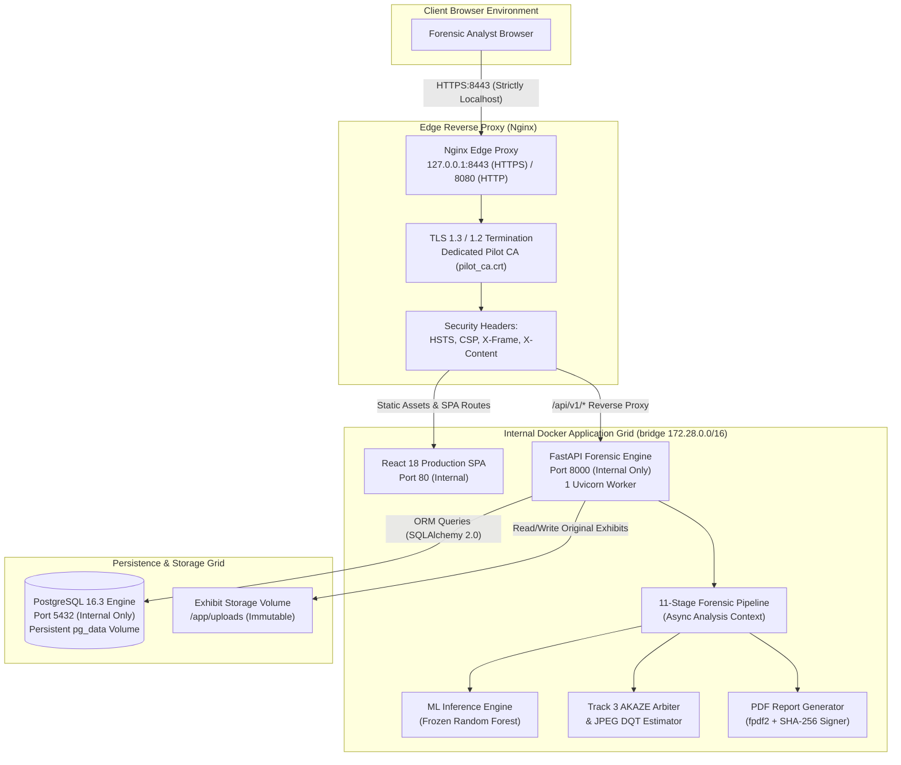
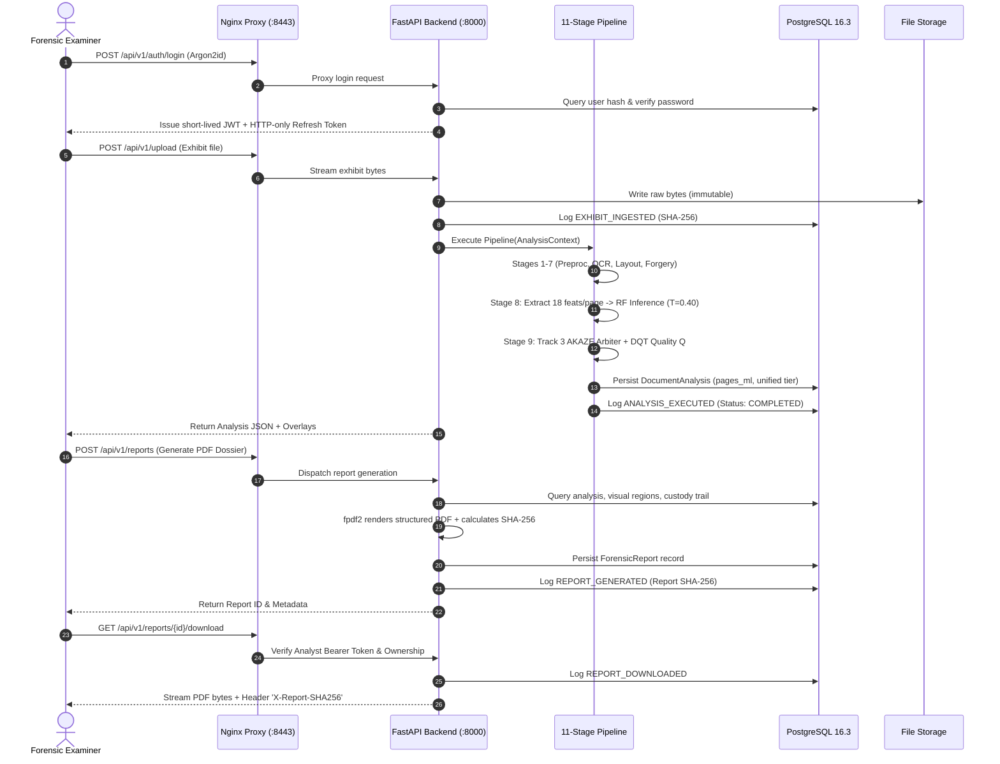

# VisionForensics AI — Final System Architecture
## Multi-Tier Architecture, Forensic Pipeline, and System Engineering

**Document Reference:** `VF-ARCH-FINAL-20261101`  
**System Status:** **ACCEPTED & OPERATIONAL**  
**Architecture Topology:** Isolated Multi-Container Service Grid  
**Date:** November 1, 2026

---

## 1. Multi-Tier System Topology

VisionForensics AI is engineered as an enterprise-grade, microservice-inspired modular platform. The architecture separates untrusted network traffic, presentation rendering, stateful business logic, and forensic execution into distinct isolation zones.

### Component Roles & Responsibilities:

1. **Client Layer (React 18 SPA):**
   - Built with Vite, React 18, TypeScript, and Tailwind CSS.
   - Provides interactive canvas overlays for multi-page documents, bounding-box inspection of detected anomalies, dual-document differential alignment, and real-time risk indicators.
2. **Gateway Layer (Nginx Reverse Proxy):**
   - Binds strictly to `127.0.0.1:8443` (TLS) and `127.0.0.1:8080` (HTTP to HTTPS 301 redirect).
   - Enforces transport security via a dedicated internal Certificate Authority (`ca/pilot_ca.crt`).
   - Injects security hardening headers: `Strict-Transport-Security`, `X-Content-Type-Options: nosniff`, `X-Frame-Options: DENY`, `Content-Security-Policy`.
3. **Application Layer (FastAPI Backend):**
   - Single Uvicorn worker process (`--workers 1`), strictly preserving in-memory rate limiting consistency across incoming forensic intake streams.
   - Operates on internal port `8000` (completely unexposed to the host network).
   - Orchestrates the 11-stage asynchronous forensic pipeline.
4. **Data Persistence Layer (PostgreSQL 16.3):**
   - Relational store for users, exhibits, pipeline stage outputs, comparison records, reports, and append-only audit ledgers.
   - Backed by persistent Docker volume `visionforensics-pilot-pgdata`.

---

## 2. The 11-Stage Forensic Processing Pipeline

When a document exhibit is uploaded, it is encapsulated in an asynchronous `AnalysisContext` and dispatched through 11 sequential, decoupled pipeline stages:

```mermaid
flowchart LR
    S1["1. Upload & Ingestion"] --> S2["2. Preprocessing & Normalization"]
    S2 --> S3["3. Optical Character Recognition"]
    S3 --> S4["4. Layout Structure Analysis"]
    S4 --> S5["5. Metadata & Container Inspection"]
    S5 --> S6["6. Forgery & Anomaly Detection"]
    S6 --> S7["7. Document Type Classification"]
    S7 --> S8["8. Multi-Page ML Inference"]
    S8 --> S9["9. Risk Synthesis Arbiter"]
    S9 --> S10["10. Feature Explainability"]
    S10 --> S11["11. Forensic Report Preparation"]
```

### Granular Stage Breakdown:

| Stage # | Stage Name | Implementation Class | Responsibilities & Forensic Output |
| :---: | :--- | :--- | :--- |
| **1** | **Upload** | `UploadStage` | Validates MIME type, computes SHA-256 hash, stores original bytes to immutable volume, creates initial PostgreSQL exhibit custody record. |
| **2** | **Preprocessing** | `PreprocessingStage` | Detects file format. For PDFs, executes adaptive multi-page rendering using `pypdfium2` preserving native aspect ratio. Derives luminance channel. |
| **3** | **OCR** | `OCRStage` | Extracts textual elements, bounding boxes, character confidences, and parses Machine-Readable Zones (MRZ) where present. |
| **4** | **Layout** | `LayoutStage` | Analyzes structural document geometry, text line alignments, margin symmetry, and field bounding boxes. |
| **5** | **Metadata** | `MetadataStage` | Extracts EXIF headers, PDF structural trailers, creation timestamps, and software editing signatures. |
| **6** | **Forgery** | `ForgeryStage` | Executes localized anomaly detectors: ELA (Error Level Analysis), noise variance mapping, gradient edge analysis, and AKAZE copy-move keypoint matching. |
| **7** | **Classification** | `DocumentClassificationStage` | Infers document category (Driving License, ID Card, Passport, Dossier) via geometric aspect ratios and extracted keyword profiles. |
| **8** | **ML Inference** | `MLInferenceStage` | **Track 1:** Extracts 18 active numerical features per page (`extract_page`). Evaluates frozen Random Forest at $T = 0.40$. Executes logarithmic multi-page significance aggregation ($T_N$). Populates `pages_ml`. |
| **9** | **Risk Synthesis** | `RiskStage` | **Track 3 & Arbiter:** Non-destructively extracts JPEG DQT tables ($Q$). Evaluates copy-move clusters (`cm_pairs`, inliers). Applies borderline qualification and visual escalation. Produces unified risk tier (`LOW_RISK`, `SUSPICIOUS`, `HIGH_RISK`). |
| **10** | **Explainability** | `ExplainabilityStage` | Computes feature importance rankings and local attributions identifying the top numerical features driving the ML probability. |
| **11** | **Report Prep** | `ReportStage` | Formats comprehensive JSON findings, constructs serializable decision traces, and prepares assets for investigation dossier export. |

---

## 3. End-to-End Forensic Workflow Sequence

The sequence diagram below details the operational interaction across components from intake to verified PDF export:

---

## 4. Cryptographic Chain of Custody & Storage Integrity

Forensic integrity requires that physical evidence is tamper-evident from the microsecond of ingestion.

### Chain-of-Custody Implementation:
- **Append-Only Custody Ledger:** Handled by the `exhibit_custody_logs` table in PostgreSQL. Every physical interaction generates an immutable audit record:
  - `EXHIBIT_INGESTED` (Initial SHA-256 computation).
  - `ANALYSIS_EXECUTED` (Pipeline completion timestamp).
  - `EXHIBIT_ACCESSED` (Analyst retrieval of preview).
  - `EXHIBIT_IMAGE_ACCESSED` (Direct raw byte retrieval).
  - `REPORT_GENERATED` (PDF dossier generation).
  - `REPORT_DOWNLOADED` (Export of signed PDF).
  - `DOCUMENT_COMPARISON_PERFORMED` (Comparative alignment event).
  - `TAMPERING_ALARM` (Immediate security event on hash mismatch).
- **Active Physical Tamper Detection:**
  Whenever an exhibit is requested for preview, analysis, or export, [`StorageService.get_file`](file:///d:/Forgery%20Detection%20ML/backend/app/services/storage_service.py) recalculates the SHA-256 checksum of the stored disk bytes and compares it against `document.file_hash`.
  - If a single bit differs: Application aborts with `HTTP 409 Conflict`, records a `TAMPERING_ALARM` in PostgreSQL, and locks the exhibit from further processing.

---

## 5. Network Perimeter & Isolation Architecture

To ensure strict operational containment during controlled pilot evaluation:

1. **Host Binding Isolation:**
   - Docker Compose configuration (`docker-compose.pilot.yml`) maps ports strictly to the loopback interface:
     - `127.0.0.1:8443:8443`
     - `127.0.0.1:8080:80`
   - Neither the backend API (`8000`) nor PostgreSQL (`5432`) is published to the host network.
2. **Restricted Database Role:**
   - Runtime backend container connects to PostgreSQL using the unprivileged `vf_pilot_user` role, lacking superuser, database creation, or schema-altering privileges.
3. **Internal Subnet Trust Restriction:**
   - Uvicorn enforces `--forwarded-allow-ips "172.28.0.0/16"`, trusting exclusively proxy headers forwarded from the internal Nginx IP. Spoofed external `X-Forwarded-For` headers are discarded.
