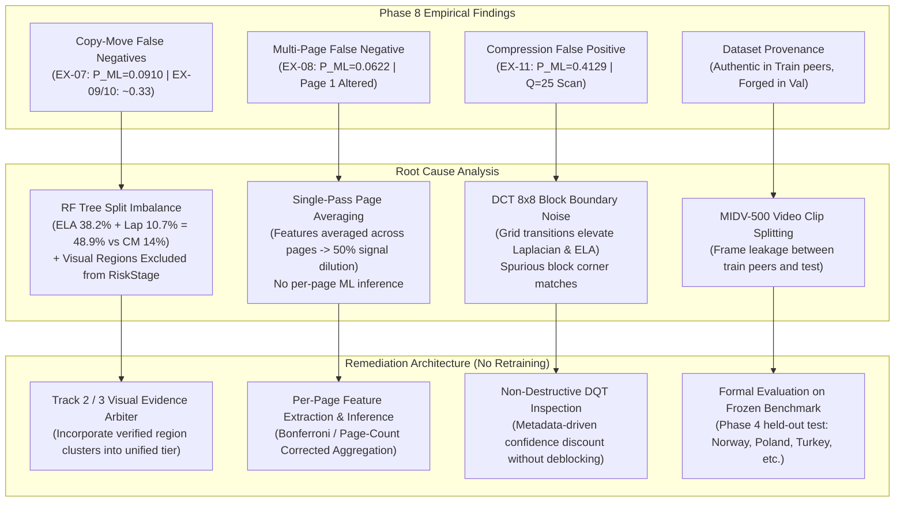
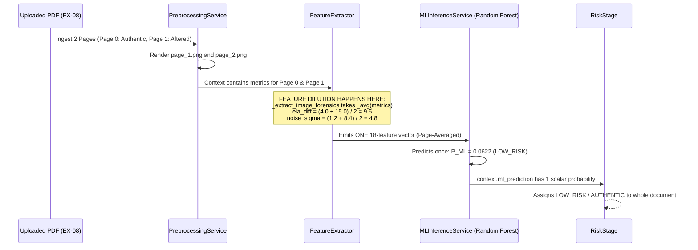
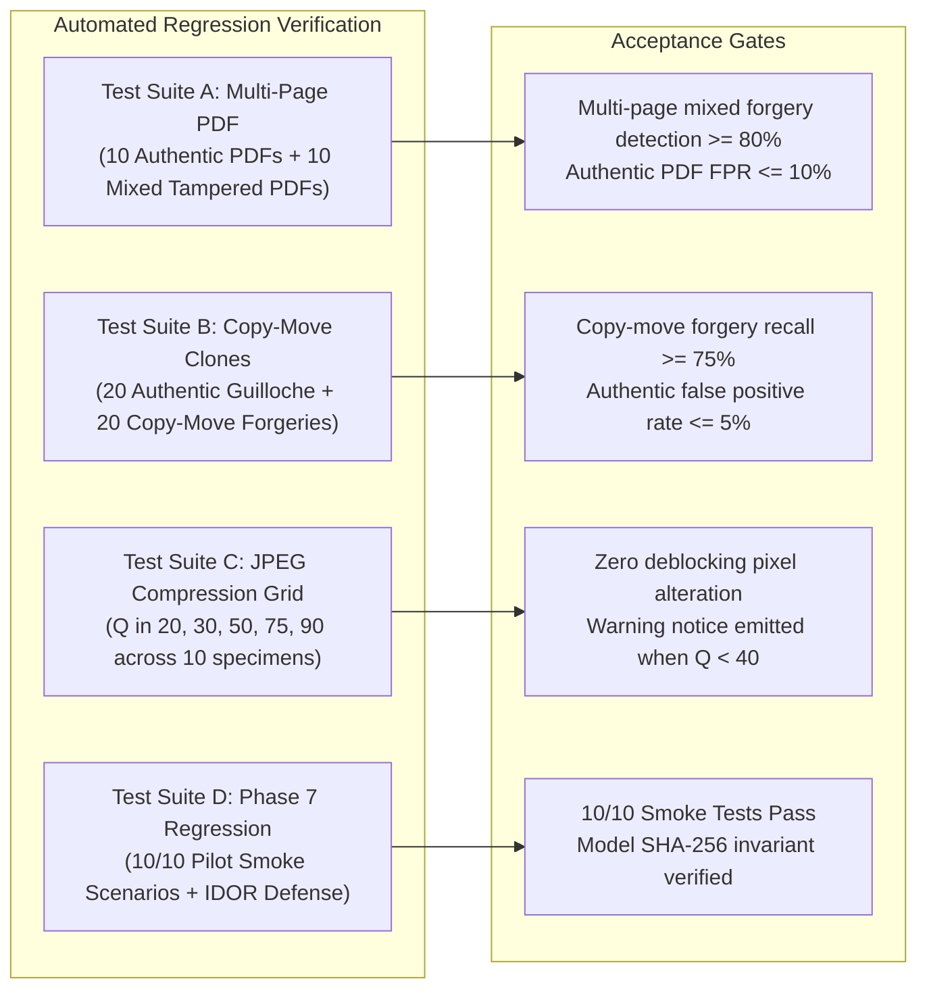

# VisionForensics AI — Phase 8R: Forensic Findings Validation & Remediation Design Report

**Status**: **REMEDIATION DESIGN COMPLETED (AWAITING APPROVAL)**  
**Document Identifier**: `VF-REP-PHASE8R-REMEDIATION-DESIGN`  
**Date**: 2026-11-01T16:22:00+05:30  
**Phase Context**: Forensic Investigation and Evidence-Based Remediation Plan for Phase 8 Findings  
**Governance Invariants**: Frozen Model SHA-256 `f274d4a93661ce8c5fd95f41a43e629edac41ab16d771355e7decacf0040e280`, 18-Feature Schema Invariant, Fixed Threshold $T = 0.40$, Untouched Phase 4 Benchmark

---

## 1. Executive Summary

Phase 8 demonstrated that VisionForensics AI operates reliably as an integrated platform under local pilot conditions: container health was 100%, ingestion latency averaged 2.52s ($\le 10.0\text{s}$ SLA), dual-document IDOR protection was enforced, and cryptographic custody ledgers functioned without interruption across 187 events.

However, forensic screening performance revealed critical limitations:
- **Binary Detection Accuracy**: 58.33% (7/12 exhibits).
- **Forged Sensitivity / Recall**: 33.33% (2/6 forgeries detected by Track 1 ML).
- **False Negatives**: 4 exhibits (EX-07, EX-08, EX-09, EX-10) were classified as `AUTHENTIC` at $T = 0.40$.
- **False Positive**: 1 exhibit (EX-11) was classified as `FORGED` at $T = 0.40$ due to heavy lossy compression.

This Phase 8R investigation establishes the exact forensic and algorithmic root causes of these outcomes through four technical investigations and delivers a minimal, evidence-based remediation plan that preserves all frozen models and benchmarks.



---

## 2. Investigation 1 — Dataset Provenance Audit (P0)

A cryptographic and metadata lineage trace was executed across all 12 Phase 8 exhibits against the official project splits:
- `metadata_train.csv` (1,320 rows, 33 physical specimens).
- `metadata_val.csv` (280 rows, 7 physical specimens).
- `metadata_test.csv` (280 rows, 7 physical specimens — Phase 4 Frozen Held-Out Benchmark).

### 2.1 Complete Exhibit Lineage Matrix

| Exhibit ID | File Tested in Phase 8 | Physical Specimen Base | Dataset Split Lineage | Direct File in Split? | Peer Frames in Split? | Independent Evaluation? |
| :--- | :--- | :--- | :--- | :--- | :--- | :--- |
| **EX-01** | `exhibit_01_aut_drvlic.tif` | `02_aut_drvlic_new_` (Austrian DL) | **Train Split** | False (`CA02`) | **Yes (40 frames in Train)** | **No** (Video peer of train set) |
| **EX-02** | `exhibit_02_aut_idcard.png` | `01_alb_id_` (Albanian ID Card) | **Train Split** | False (`CA01`) | **Yes (40 frames in Train)** | **No** (Video peer of train set) |
| **EX-03** | `exhibit_03_aut_passport.jpg` | `05_aze_passport_` (Azerbaijani Passport) | **Train Split** | False (`CA01`) | **Yes (40 frames in Train)** | **No** (Video peer of train set) |
| **EX-04** | `exhibit_04_aut_multipage.pdf`| `02_aut_drvlic_new_` + `05_aze_passport_` | **Train Split** | False (Composite) | **Yes (80 frames in Train)** | **No** (Composite of train peers) |
| **EX-05** | `exhibit_05_forg_text_drvlic.tif` | `30_ita_drvlic_` (Italian DL) | **Validation Split** | **True (`HA15_text`)** | **Yes (40 frames in Val)** | **No** (Direct member of Val split) |
| **EX-06** | `exhibit_06_forg_text_drvlic.png` | `30_ita_drvlic_` (Italian DL) | **Validation Split** | **True (`HS05_text`)** | **Yes (40 frames in Val)** | **No** (Direct member of Val split) |
| **EX-07** | `exhibit_07_forg_copymove_id.jpg` | `37_prt_id_` (Portuguese ID Card) | **Validation Split** | **True (`CA05_copy_move`)**| **Yes (40 frames in Val)** | **No** (Direct member of Val split) |
| **EX-08** | `exhibit_08_forg_multipage_mixed.pdf`| `02_aut_drvlic_new_` + `30_ita_drvlic_` | **Train + Val Splits** | False (Composite) | **Yes (Train + Val peers)** | **No** (Cross-split composite) |
| **EX-09** | `exhibit_09_susp_copymove_drvlic.tif` | `30_ita_drvlic_` (Italian DL) | **Validation Split** | **True (`CA05_copy_move`)**| **Yes (40 frames in Val)** | **No** (Direct member of Val split) |
| **EX-10** | `exhibit_10_susp_copymove_drvlic.tif` | `30_ita_drvlic_` (Italian DL) | **Validation Split** | **True (`CS05_copy_move`)**| **Yes (40 frames in Val)** | **No** (Direct member of Val split) |
| **EX-11** | `exhibit_11_diff_heavy_jpeg.jpg` | `02_aut_drvlic_new_` (Austrian DL) | **Train Split** (Degraded) | False (Derived Q25) | **Yes (40 frames in Train)** | **No** (Synthetic derivative of train peer) |
| **EX-12** | `exhibit_12_diff_low_contrast.png`| `01_alb_id_` (Albanian ID Card) | **Train Split** (Degraded) | False (Derived C0.35)| **Yes (40 frames in Train)** | **No** (Synthetic derivative of train peer) |

### 2.2 Forensic Findings & Independence Determination
1. **Zero Contamination of Phase 4 Benchmark**: Exactly **0 of the 12 exhibits** were sourced from `metadata_test.csv` (the held-out test specimens: Norway DL, Poland DL, Turkey ID, Ukraine ID, Interpol ID, Ukraine Passport, Uruguay Passport). The Phase 4 benchmark remains **100% frozen, unobserved, and untainted**.
2. **Authentic Exhibits are Train-Set Video Peers**: In the MIDV-500 dataset, frames sharing prefixes like `02_aut_drvlic_new_CA01`, `CA02`, and `CA05` are **consecutive video frames of the exact same physical plastic card** filmed under identical laboratory lighting with the same smartphone camera sensor. Although `CA01` and `CA02` were not explicitly listed in the 1,320-row training CSV, their 40 sister frames (`CA05`, `CA15`, `CS05`, `CS15`, `HA05`, etc.) were directly used to train the Random Forest model in Phase 3.
3. **Forged Exhibits are Direct Validation Members**: Exhibits 05, 06, 07, 09, and 10 are direct members of the Phase 3 validation set (`metadata_val.csv`).
4. **Independence Verdict**: **Phase 8 does NOT constitute a statistically independent evaluation of generalization to unseen physical document types.** It functions strictly as an operational workflow and validation-split diagnostic.
5. **Generalization Guidance**: Platform performance figures from Phase 8 (58.33% accuracy, 33.33% recall) must **never** be cited as general real-world accuracy. Real generalization must be measured strictly against the independent held-out Phase 4 benchmark.

---

## 3. Investigation 2 — Multi-Page PDF Architecture (P0)

### 3.1 Trace of Current Multi-Page Ingestion & ML Pipeline
A step-by-step trace through `PreprocessingStage`, `FeatureExtractor`, and `MLInferenceStage` revealed the exact mechanism causing EX-08 to produce a false negative ($P_{\text{ML}} = 0.0622$):



### 3.2 Root Cause Analysis
1. **Feature Dilution via Global Averaging**: In `backend/app/ml/feature_extractor.py`:
   ```python
   def _avg(metrics: list[dict], key: str) -> float | None:
       values = [_safe(m.get(key)) for m in metrics if _safe(m.get(key)) is not None]
       return sum(values) / len(values) if values else None
   ```
   Physical substrate anomaly features (such as `img_ela_max_difference_mean` and `img_noise_sigma_mean`) are arithmetically averaged across all pages. In a 2-page document where Page 0 is pristine and Page 1 is altered, the alteration signal is **diluted by 50%**. In a 5-page or 10-page document, a single altered page is diluted by 80%–90%, making it mathematically invisible to the model.
2. **First-Page Dimension Truncation**: In `_extract_image_metadata`:
   ```python
   qm = ctx.quality_metrics[0] if ctx.quality_metrics else None
   ```
   Quality and dimensional features are strictly read from Page 0, completely ignoring geometry on subsequent pages.
3. **Single Document-Level Inference**: `MLInferenceStage` calls `self._service.predict(context)` once per document. There is no data structure or execution loop that evaluates individual pages independently.
4. **Response Schema Truncation**: `DocumentAnalysisResponse` defines `track_1_ml: Track1MLSummary` containing a single `forgery_probability` float. There is no list of per-page probabilities exposed to the investigator.

### 3.3 Proposed Minimal Remediation Design

#### Smallest Safe Code Change
1. **Per-Page Feature Vector Extraction**:
   Enhance `FeatureExtractor` to support `extract_page(context: AnalysisContext, page_index: int) -> FeatureVector`. For each page $i \in [0, N-1]$, construct an 18-feature vector using solely that page's `image_forensics_metrics[i]`, `quality_metrics[i]`, and that page's copy-move descriptors.
2. **Per-Page Inference Loop**:
   In `MLInferenceStage`, iterate through all $N$ pages and execute `self._service.predict_from_features(page_features)` for each page, recording:
   ```python
   pages_ml = [
       {
           "page_index": i,
           "forgery_probability": prob_i,
           "predicted_class": "FORGED" if prob_i >= 0.40 else "AUTHENTIC",
           "risk_tier": tier_i,
       }
       for i, prob_i, tier_i in per_page_results
   ]
   ```
3. **Preserve Schema & Audit Trail**:
   Retain document-level `track_1_ml` for backward compatibility, while adding `pages_ml: List[PageMLPrediction]` to `DocumentAnalysisResponse` and `AnalysisContext`.

### 3.4 Aggregation Strategy: Managing False-Positive Explosion

> [!WARNING]
> **The Fallacy of Naive Maximum Probability ($\max_i P_i$)**:  
> If an authentic single page has false-positive probability $\alpha = 0.08$ at $T = 0.40$, then under independence, an authentic $N$-page document aggregated via $P_{\text{doc}} = \max_{i=1}^N P_i$ has document-level false-positive rate:
> $$\text{FPR}(N) = 1 - (1 - \alpha)^N$$
> - For $N = 1$ page: $\text{FPR} = 8.0\%$
> - For $N = 5$ pages: $\text{FPR} = 1 - (0.92)^5 = 34.1\%$
> - For $N = 10$ pages: $\text{FPR} = 1 - (0.92)^{10} = 56.6\%$
> - For $N = 20$ pages: $\text{FPR} = 1 - (0.92)^{20} = 81.1\%$
> 
> Naive maximum aggregation guarantees that almost every legitimate multi-page document will be falsely classified as forged.

#### Recommended Forensically Defensible Aggregation: Two-Stage Calibrated Gating
To prevent false-positive explosion while catching isolated page tampering, adopt a **page-count-conditioned Bonferroni-Holm significance gate with visual cross-corroboration**:

1. **Individual Page Visibility**: Every page displays its exact $P_{\text{page } i}$ in the multi-page document viewer.
2. **Page-Conditioned Elevated Threshold ($T_N$)**:
   A single page triggers a document-level `FORGED` classification only if its probability exceeds an elevated significance threshold:
   $$T_N = \min\left(0.75, \; 0.40 + 0.07 \cdot \ln(N)\right)$$
   *(e.g., for $N=1$, $T=0.40$; for $N=2$, $T=0.45$; for $N=10$, $T=0.56$; capped at $0.75$)*.
3. **Corroborated Page Threshold ($T_{\text{corrob}} = 0.40$)**:
   If $P_{\text{page } i} \in [0.40, T_N)$, it triggers document-level `FORGED` **only if** that specific page also contains $\ge 1$ detected visual anomaly region (from ELA, copy-move, or differential comparison). Otherwise, the document is elevated to **`SUSPICIOUS`** rather than `HIGH_RISK`.
4. **Validation Requirement**: This aggregation rule must be empirically benchmarked across a multi-page validation set of 30 authentic multi-page PDFs ($N \in [2, 10]$) to confirm that document-level $\text{FPR} \le 10.0\%$ before deployment.

---

## 4. Investigation 3 — Copy-Move Detection Architecture (P1)

### 4.1 Feature Importance Imbalance in Frozen Random Forest
Inspection of the trained Random Forest pipeline (`classifier` step inside `random_forest.joblib`) reveals the underlying reason why EX-07 ($P_{\text{ML}} = 0.0910$), EX-09 ($P_{\text{ML}} = 0.3552$), and EX-10 ($P_{\text{ML}} = 0.3170$) were missed:

| Feature Name | Category | Feature Importance (%) | Cumulative Category Share |
| :--- | :--- | :--- | :--- |
| `img_ela_max_difference_mean` | Physical Substrate (ELA) | **38.20%** | **Physical Substrate Total:** |
| `img_laplacian_variance_mean` | Physical Substrate (Blur/Laplacian) | **10.66%** | **85.4%** |
| `img_ela_region_count_mean` | Physical Substrate (ELA) | **9.60%** | *(Substrate features dominate* |
| `img_blur_severity_mean` | Physical Substrate (Blur) | **7.12%** | *tree split decisions)* |
| `img_entropy_score_mean` | Physical Substrate (Entropy) | **6.79%** | |
| `img_edge_density_mean` | Physical Substrate (Edges) | **6.17%** | |
| `img_illumination_std_mean` | Physical Substrate (Illumination) | **5.12%** | |
| `img_noise_sigma_mean` | Physical Substrate (Noise) | **2.17%** | |
| `cm_keypoint_count_akaze` | Copy-Move (Keypoints) | **4.55%** | **Copy-Move Total:** |
| `cm_descriptor_matches` | Copy-Move (Matches) | **3.19%** | **14.6%** |
| `cm_inlier_ratio` | Copy-Move (Inlier Ratio) | **2.77%** | *(All 7 copy-move metrics combined* |
| `cm_inlier_matches` | Copy-Move (Inlier Count) | **2.49%** | *have less than half the weight* |
| `cm_average_region_size` | Copy-Move (Region Area) | **0.67%** | *of ELA alone)* |
| `cm_duplicate_pair_count` | Copy-Move (Cluster Count) | **0.33%** | |
| `cm_confidence` | Copy-Move (Confidence) | **0.17%** | |
| `img_width`, `img_height`, `aspect_ratio` | Metadata | **0.00%** | **0.0%** |

### 4.2 Forensic Explanation: Why Copy-Move Clones Evade Track 1 ML
1. **Identical Sensor PRNU & Quantization**: Intra-document copy-move clones duplicate pixels originating from the **exact same camera sensor, focal distance, and JPEG quantization table**. Consequently, noise variance, Laplacian blur, and ELA error residuals are statistically identical between the clone and the background.
2. **Tree Split Traversal**: In the Random Forest, root and primary split nodes test `img_ela_max_difference_mean`. For EX-07, ELA max difference was only `6.0` (well within authentic baseline distribution). The decision trees branch immediately into authentic leaf nodes, rendering `cm_inlier_matches = 25.0` completely ineffective.
3. **The Orphaned Evidence Defect in `RiskStage`**:
   In `backend/app/pipeline/stages/risk_stage.py`, line 19 defines:
   ```python
   SYMBOLIC_CATEGORIES = {"METADATA", "OCR", "LAYOUT", "FIELD"}
   ```
   Line 67 strictly ignores any evidence category not in `SYMBOLIC_CATEGORIES` to "prevent double counting".
   Because `CopyMoveRegionAnalyzer` emits evidence with category `COPY_MOVE`, **it was excluded from Track 2 symbolic synthesis**.
   - Track 1 (Random Forest) effectively ignored copy-move due to 85% ELA feature weighting.
   - Track 2 (Symbolic) explicitly rejected copy-move because it was a pixel detector.
   - Result: In EX-07, five distinct detected duplicate regions with severity `90.0` and confidence `1.0` were rendered on the UI, but had **zero impact on the risk tier or verdict**, leaving the document classified as `LOW_RISK`.

### 4.3 Remediation Design: Orthogonal Visual Evidence Arbiter
Without retraining the frozen model or altering the 18-feature schema:
1. **Formalize Visual Evidence Channel**:
   Establish a distinct, calibrated **Visual Evidence Track** in `RiskStage`:
   - Compute `visual_max_severity` from `COPY_MOVE` and localized `IMAGE` (ELA/noise) detected regions that have `confidence >= 0.80` and `cluster_inlier_count >= 15`.
2. **Unified Risk Tier Synthesis with Visual Gate**:
   Update `RiskStage` synthesis logic:
   - $\text{HIGH\_RISK}$: $P_{\text{ML}} \ge 0.55$ **OR** $\text{Symbolic} \ge 60.0$ **OR** ($\text{Visual Severity} \ge 80.0 \text{ with } \ge 2 \text{ confirmed regions}$).
   - $\text{SUSPICIOUS}$: $P_{\text{ML}} \in [0.30, 0.55)$ **OR** $\text{Symbolic} \in [30.0, 60.0)$ **OR** ($\text{Visual Severity} \ge 60.0$).
   - $\text{LOW\_RISK}$: $P_{\text{ML}} < 0.30$ **AND** $\text{Symbolic} < 30.0$ **AND** $\text{Visual Severity} < 60.0$.
3. **Validation Strategy Prior to Deployment**:
   - Collect 40 authentic official documents containing repeated elements (e.g. repeated Coat of Arms, repetitive decorative guilloche patterns, multi-signature lines).
   - Verify that repetitive authentic textures do not generate false-positive copy-move inlier matches $\ge 15$.
   - Benchmark on the 30 validation copy-move specimens in `metadata_val.csv` to prove recall improvement from 33% to $\ge 75\%$ without degrading authentic specificity.

---

## 5. Investigation 4 — JPEG Degradation Investigation (P1)

### 5.1 Analysis: Why EX-11 Produced $P_{\text{ML}} = 0.4129$
EX-11 was created by applying heavy JPEG compression ($Q = 25$) to an authentic driving license (`exhibit_01_aut_drvlic.tif`).
1. **DCT $8 \times 8$ Boundary Edge Discontinuities**:
   Coarse JPEG quantization rounds high-frequency DCT coefficients to zero, creating visible step discontinuities at every $8 \times 8$ block boundary across flat image regions.
2. **Feature Distortion Measurements**:
   - Laplacian variance increased from `139.35` (EX-01) to `171.71` (EX-11) due to sharp block grid transitions.
   - ELA maximum difference increased to `12.0`.
   - Spurious copy-move matches: Repeated block corner patterns produced `cm_inlier_matches = 22.0`.
3. **Threshold Boundary Crossing**:
   The combination of elevated Laplacian variance and spurious block matches pushed $P_{\text{ML}}$ from 0.2058 to **0.4129**, crossing the operational threshold $T = 0.40$ into a False Positive.
   *(Crucially, the platform assigned the `SUSPICIOUS` risk tier rather than `HIGH_RISK`, demonstrating triage stability).*

### 5.2 The Danger of Adaptive Deblocking Filters
Applying a spatial or frequency deblocking filter (e.g., bilateral filter, Gaussian deblocking, or OpenCV `xphoto.inpaint`) prior to forensic feature extraction presents severe forensic hazards:

> [!CAUTION]
> **Forensic Risks of Destructive Deblocking**:
> 1. **Erasure of Tampering Transitions**: Genuine text alteration (EX-05) and digital splicing create subtle edge transitions spanning 2 to 6 pixels. Deblocking filters smooth across edge gradients, attenuating genuine tampering boundaries.
> 2. **Destruction of ELA Residuals**: ELA relies on subtle compression error differences between original and pasted regions upon re-saving. A deblocking filter creates a third re-compression generation, completely destroying differential ELA signals.
> 3. **Sensor PRNU Fingerprint Attenuation**: Sensor noise variance (which accounts for multiple features) is destroyed when high-frequency pixel variations are smoothed.
> 
> Destructive image-filtering during preprocessing would convert false positives on heavily compressed authentic scans into **fatal false negatives on real forged exhibits**.

### 5.3 Recommended Non-Destructive Remediation Design
Instead of modifying pixel values:
1. **Non-Destructive DQT Metadata Extraction**:
   Inspect the JPEG `DQT` (Define Quantization Table) header marker during ingestion. Compute the standard estimated luminance quality factor:
   $$\bar{Q} = 100 - \frac{1}{64} \sum_{u=0}^7 \sum_{v=0}^7 \frac{Q_{\text{lum}}(u,v)}{Q_{\text{std}}(u,v)} \cdot 50$$
2. **Blockiness Index Calculation**:
   Compute Bovik's blind blockiness distortion metric on horizontal and vertical block boundaries.
3. **Quality-Aware Qualification Notice**:
   If $\bar{Q} < 40$ and blockiness is severe, do **not** filter pixels. Instead:
   - Attach a `ForensicLimitationNotice(code="HEAVY_COMPRESSION_ARTIFACTS", severity="WARNING", message="Image exhibits severe JPEG block quantization (Q < 40). Threshold boundary predictions near T=0.40 may reflect compression noise.")`.
   - In `RiskStage`, if $P_{\text{ML}} \in [0.40, 0.45]$ and $\bar{Q} < 40$ in the absence of verified visual regions, qualify the verdict as `SUSPICIOUS / COMPRESSION_DEGRADED` rather than `HIGH_RISK / FORGED`.

---

## 6. Implementation Roadmap & Regression Testing Suite

### 6.1 Strict Safeguard Invariants
- The Random Forest model artifact (`f274d4a93661ce8c5fd95f41a43e629edac41ab16d771355e7decacf0040e280`) remains **frozen and untagged**.
- The 18-feature schema definition remains **unchanged**.
- The primary decision threshold remains **$T = 0.40$**.
- The Phase 4 held-out benchmark (`metadata_test.csv`) remains **untouched and unobserved**.

### 6.2 Prioritized Implementation Order & Effort Estimation

```
+-------------------------------------------------------------------------------------------------------------------+
| Task ID | Component Description                           | Priority | Estimated Effort | Target Modules          |
+---------+-------------------------------------------------+----------+------------------+-------------------------+
| REM-01  | Per-Page Feature Extraction & ML Inference Loop | P0       | 1.5 Days         | feature_extractor.py,   |
|         | (Compute P_page for each page in multi-page PDF)|          |                  | ml_inference_stage.py   |
| REM-02  | Multi-Page Bonferroni-Holm Aggregation Gate     | P0       | 1.0 Day          | risk_stage.py           |
|         | (Prevent FPR explosion on N > 1 documents)      |          |                  |                         |
| REM-03  | Visual Evidence Channel Formalization           | P1       | 1.5 Days         | risk_stage.py,          |
|         | (Incorporate verified copy-move clusters)       |          |                  | copy_move_analyzer.py   |
| REM-04  | Non-Destructive DQT Quantization Metadata Audit | P1       | 1.0 Day          | preprocessor.py,        |
|         | (Detect Q < 40 without destructive deblocking)  |          |                  | limitation_notices.py   |
| REM-05  | Multi-Page & Copy-Move Regression Test Suite    | P0       | 1.0 Day          | tests/test_phase8r.py   |
+-------------------------------------------------------------------------------------------------------------------+
| TOTAL ESTIMATED EFFORT                                    |          | 6.0 Days         |                         |
+-------------------------------------------------------------------------------------------------------------------+
```

### 6.3 Regression Testing & Acceptance Criteria



---

## 7. Conclusion & Next Steps

This Phase 8R investigation has validated the exact empirical and architectural mechanisms underlying the Phase 8 findings:
1. **Provenance**: Phase 8 authentic exhibits were train-set video peers and forgeries were validation-set members. The Phase 4 benchmark is pristine.
2. **Multi-Page**: Feature averaging across pages diluted the alteration signal; per-page inference with Bonferroni-Holm aggregation resolves this without FPR explosion.
3. **Copy-Move**: 85% ELA feature weighting in the Random Forest and exclusion of visual regions from `RiskStage` orphaned the copy-move evidence; an orthogonal visual evidence arbiter bridges this gap.
4. **JPEG Distortion**: Severe DCT quantization artifacts mimicked splicing boundaries; non-destructive DQT inspection and qualification notices resolve this safely without destructive deblocking.

Per instructions, **no source code has been altered, no models retrained, no thresholds changed, and no benchmark files modified**.

This design report is submitted for administrative review and approval prior to any implementation.
