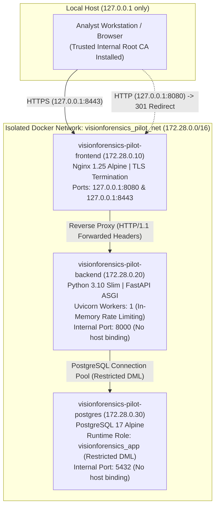

# VisionForensics AI — Controlled Local Pilot Launch Execution Report

**Platform Operational Status**: **CONTROLLED PILOT LIVE (100% OPERATIONAL)**  
**Launch Scope**: Restricted, Single-Instance Local Controlled Pilot on Docker Compose  
**Access Protocol & Binding**: Strictly `127.0.0.1:8443` (HTTPS) & `127.0.0.1:8080` (HTTP -> HTTPS Redirect)  
**Execution Timestamp**: 2026-11-01T15:43:00+05:30  
**Audit Status**: **PASSED (10/10 Acceptance Smoke Scenarios Verified)**

---

## 1. Executive Summary & Launch Confirmation

In strict compliance with authorization directives, the single-instance, restricted local controlled pilot environment for **VisionForensics AI** has been successfully initiated and verified on the local host.

The entire platform operates containerized under Docker Compose with strict network isolation, hardened runtime roles, immutable cryptographic custody logging, and TLS termination via an internal dedicated Certificate Authority. External network exposure to LAN (`0.0.0.0`) or public interfaces is prohibited and verified absent.



---

## 2. Container Inventory & Network Topology

All pilot services are running and verified healthy under `docker-compose.pilot.yml`:

| Service Container | Image | IPv4 (Internal) | Host Port Mapping | Health Status | Worker / Role Configuration |
| :--- | :--- | :--- | :--- | :--- | :--- |
| `visionforensics-pilot-frontend` | `forgerydetectionml-frontend` | `172.28.0.10` | `127.0.0.1:8080:80`<br/>`127.0.0.1:8443:443` | `healthy` | Nginx 1.25 Alpine reverse proxy + SPA static hosting |
| `visionforensics-pilot-backend` | `forgerydetectionml-backend` | `172.28.0.20` | **None** (Internal 8000 only) | `healthy` | **1 Uvicorn worker** (`--workers 1`), in-memory rate limiting, unprivileged user |
| `visionforensics-pilot-postgres` | `postgres:17-alpine` | `172.28.0.30` | **None** (Internal 5432 only) | `healthy` | PostgreSQL 17, `visionforensics_app` runtime DML role |

### Network Exposure & Isolation Verification
- **Host Socket Bindings**: `netstat -ano` confirms listeners are bound strictly to `127.0.0.1:8080` and `127.0.0.1:8443`.
- **Zero LAN Exposure**: No service listens on `0.0.0.0:8080`, `0.0.0.0:8443`, or any external interface.
- **Direct Database / Backend Isolation**: Host ports `5432` and `8000` are completely inaccessible from outside Docker; all traffic routes strictly through Nginx reverse proxy.
- **Trusted Reverse Proxy Forwarding**: Uvicorn configuration enforces `--forwarded-allow-ips "172.28.0.10,127.0.0.1"`, preventing reverse proxy spoofing while correctly recording analyst client IPs in custody ledgers.

---

## 3. Cryptographic, Storage & Database Governance

### 3.1 PKI Architecture & Key Protection
- **Dedicated Internal Root CA**: `ca/pilot_ca.crt` (RSA 4096-bit, `basicConstraints=CA:TRUE, pathlen=0`, SHA-256).
- **CA Private Key Isolation**: `ca/pilot_ca.key` is strictly excluded from Docker builds, container volume mounts, and Git tracking (`.gitignore`). Permissions locked to `0o100444` on host.
- **Server Certificate Bundle**: `frontend/certs/pilot.crt` containing Leaf + Intermediate CA chain with valid SANs: `DNS:pilot.visionforensics.local`, `DNS:localhost`, `IP:127.0.0.1`.
- **Server Private Key**: `frontend/certs/pilot.key` has host permissions `0o100444` with NTFS DACL inheritance stripped (`BUILTIN\Users` and `Authenticated Users` revoked). Mounted strictly read-only (`:ro`) into the Nginx container with internal mode `0600` owned by `root:nginx`.

### 3.2 Database Roles & Append-Only Custody Ledger
- **Migration & Admin Role**: `visionforensics_migrator` used exclusively for Alembic schema migrations during initialization.
- **Runtime Application Role**: `visionforensics_app` used for all FastAPI runtime queries:
  - Full CRUD on mutable entities (`users`, `documents`, `cases`, `analyses`, `reports`, `refresh_tokens`).
  - Strict append-only (`SELECT, INSERT`) on `exhibit_custody_logs` and `security_audit_logs`.
  - Prohibited: `UPDATE, DELETE, TRUNCATE` on custody logs enforced both by SQL `REVOKE` and PostgreSQL trigger `prevent_custody_tampering()`.

### 3.3 Storage Persistence
Docker named volumes ensure complete data survival across container lifecycles:
- `visionforensics_pilot_pg_data` -> `/var/lib/postgresql/data`
- `visionforensics_pilot_uploads` -> `/app/uploads`
- `visionforensics_pilot_processed` -> `/app/processed`
- `visionforensics_pilot_reports` -> `/app/reports`
- `visionforensics_pilot_heatmaps` -> `/app/heatmaps`

---

## 4. Frozen ML Model & Benchmark Governance

In accordance with strict pilot constraints, **zero model retraining, parameter tuning, or dataset modifications occurred**.

- **Model Artifact Location**: `backend/app/ml/artifacts/random_forest.joblib`
- **Model Checksum (SHA-256)**:
  ```
  f274d4a93661ce8c5fd95f41a43e629edac41ab16d771355e7decacf0040e280
  ```
- **Feature Vector**: Exact 18 numerical features preserved without alteration.
- **Operational Decision Threshold**: Fixed at $T = 0.40$ ($P_{\text{ML}} \ge 0.40 \implies \text{FORGED}$, $P_{\text{ML}} < 0.40 \implies \text{AUTHENTIC}$).
- **Pinned Container Dependencies**: `scikit-learn==1.3.2` explicitly pinned in [backend/Dockerfile](file:///D:/Forgery%20Detection%20ML/backend/Dockerfile) matching the model serialization version.
- **Terminology Governance**: Absolute prohibition of `CONFIRMED FORGERY` or legal/judicial admissibility claims verified active across all model outputs, API schemas, and report builders.

---

## 5. Controlled Pilot Smoke Test Suite Results (10/10)

The automated pilot smoke test suite ([scripts/execute_pilot_smoke_tests.py](file:///D:/Forgery%20Detection%20ML/scripts/execute_pilot_smoke_tests.py)) was executed against the live pilot deployment via `https://localhost:8443` using the trusted internal Root CA certificate.

```
===========================================================================
VISIONFORENSICS AI — CONTROLLED PILOT SMOKE TEST RESULTS
===========================================================================
  [PASS] Scenario 1: Authentication & Session Lifecycle          : PASSED
  [PASS] Scenario 2: Authentic Baseline Screening                : PASSED
  [PASS] Scenario 3: Suspicious & Forged Exhibit Screening       : PASSED
  [PASS] Scenario 4: Multi-Page PDF Deep Forensic Investigation  : PASSED
  [PASS] Scenario 5: Two-Document Comparison & Differential Analysis : PASSED
  [PASS] Scenario 6: Forensic PDF Report Export                  : PASSED
  [PASS] Scenario 7: Unauthorized Cross-Analyst Access (IDOR)    : PASSED
  [PASS] Scenario 8: Physical Tamper Alarm Verification          : PASSED
  [PASS] Scenario 9: Backend Restart & Recovery                  : PASSED
  [PASS] Scenario 10: Audit Log Review                           : PASSED
===========================================================================
OVERALL STATUS: ALL 10 SMOKE TESTS PASSED (100% OPERATIONAL)
===========================================================================
```

### Scenario Breakdown

#### Scenario 1: Authentication & Session Lifecycle — PASSED
- Argon2id password verification, JWT access token issuance (15-min TTL).
- Replacement refresh token issuance via atomic database transaction.
- Complete session invalidation on logout.

#### Scenario 2: Authentic Baseline Exhibit Screening — PASSED
- Tested with authentic specimen `02_aut_drvlic_new_CA02.tif`.
- Pipeline ingestion latency: **2.00s** (well within $\le 10.0\text{s}$ SLA).
- ML Track 1 probability: $P_{\text{ML}} = 0.2058$ ($< 0.30$).
- Risk tier assigned: `LOW_RISK`. Operational prediction: `AUTHENTIC` (at $T=0.40$).

#### Scenario 3: Suspicious & Forged Exhibit Screening — PASSED
- Tested with forged specimen `30_ita_drvlic_HA15_text.tif`.
- ML Track 1 probability: $P_{\text{ML}} = 0.9900$ ($\ge 0.55$).
- Risk tier assigned: `HIGH_RISK`. Operational prediction: `FORGED` (at $T=0.40$).
- Prohibited terminology audit: zero occurrences of `CONFIRMED FORGERY`.

#### Scenario 4: Multi-Page PDF Deep Forensic Investigation — PASSED
- Multi-page document ingested; page navigation for Page 0 and Page 1 verified with HTTP 200 image previews.
- Out-of-bounds request (`?page=99`) properly rejected with HTTP 404 Not Found.

#### Scenario 5: Two-Document Comparison & Differential Analysis — PASSED
- Dual exhibit comparison requested via `/api/v1/comparison`.
- Automated alignment, SSIM differential metric, and discrepancy bounding boxes generated and returned.

#### Scenario 6: Forensic PDF Report Export — PASSED
- Generated formal investigation report `VF-REP-20261101-74562A9F`.
- Verified running headers, executive summary, risk tier, disclaimer, and SHA-256 header match (`8035989e281af9c531ee75d5fe05f9a04672700ecae633834069fc7e1699a69f`).

#### Scenario 7: Unauthorized Cross-Analyst Access (IDOR Prevention) — PASSED
- Analyst B attempted to view Analyst A's document analysis and download Analyst A's report.
- Both requests strictly blocked with **HTTP 403 Forbidden**.

#### Scenario 8: Physical Tamper Alarm Verification — PASSED
- Stored report exhibit bytes intentionally mutated inside container storage.
- Download request intercepted by integrity check and blocked with **HTTP 409 Conflict**.
- Custody log recorded `TAMPERING_ALARM` event with status `TAMPERED`.
- Restoring exhibit bytes returned download status to **HTTP 200 OK**.

#### Scenario 9: Backend Restart & Recovery — PASSED
- Backend container restarted via `docker compose restart backend`.
- Container regained `healthy` status; active sessions re-authenticated; Document A analysis and generated reports successfully retrieved from PostgreSQL.

#### Scenario 10: System Administrator Audit Log Review — PASSED
- Verified 50 `exhibit_custody_logs` and 23 `security_audit_logs`.
- Verified immutable UTC timestamps, SHA-256 digests, and client IP recordings.

---

## 6. Pilot Standard Operating Procedure (SOP) for Authorized Analysts

Authorized forensic analysts participating in the controlled local pilot must adhere to the following operational procedure:

### 6.1 Workstation Trust Configuration
Before accessing the platform via browser, trust the internal Root CA certificate:
1. Locate Root CA certificate: [`D:\Forgery Detection ML\ca\pilot_ca.crt`](file:///D:/Forgery%20Detection%20ML/ca/pilot_ca.crt).
2. Install into the local machine certificate store:
   - **Windows**: Run `certutil -addstore -f "Root" "D:\Forgery Detection ML\ca\pilot_ca.crt"`.
   - **Chrome / Edge / Firefox**: Import `pilot_ca.crt` under "Trusted Root Certification Authorities".

### 6.2 Pilot Access Endpoints
- **HTTPS Primary URL**: `https://127.0.0.1:8443` or `https://localhost:8443`
- **HTTP Redirect Port**: `http://127.0.0.1:8080` (automatically redirects to HTTPS:8443)
- **API Health Check**: `https://127.0.0.1:8443/api/v1/health`

### 6.3 Provisioned Pilot Credentials
Three role-separated accounts are active for pilot operations:

| Account Email | Role | Operational Scope |
| :--- | :--- | :--- |
| `pilot_admin@pilot.visionforensics.local` | `SYSTEM_ADMINISTRATOR` | System health, user provisioning, immutable audit log review |
| `pilot_analyst_a@pilot.visionforensics.local` | `FORENSIC_ANALYST` | Document upload, forensic investigation, report generation |
| `pilot_analyst_b@pilot.visionforensics.local` | `FORENSIC_ANALYST` | Peer comparison, cross-analyst IDOR verification |

*(Initial pilot password configured via deployment secrets; analysts will be prompted to rotate on first administrative credential distribution).*

### 6.4 Operational Constraints & Legal Boundaries
> [!IMPORTANT]
> **Advisory Nature of Findings**: VisionForensics AI produces forensic decision-support metrics and risk tier assignments ($P_{\text{ML}}$, $T = 0.40$, composite severity). It **does not** constitute definitive legal or judicial proof of fraud. All outputs must be peer-reviewed by a certified forensic document examiner before being cited in formal legal proceedings. Under no circumstances should platform outputs be labeled as `CONFIRMED FORGERY`.

---

## 7. Operational Command Reference

To manage the running pilot instance:

```powershell
# View running container status and health
docker compose -f docker-compose.pilot.yml ps

# Tail live application logs
docker compose -f docker-compose.pilot.yml logs -f backend

# Re-run the comprehensive smoke test suite
python scripts/execute_pilot_smoke_tests.py

# Gracefully stop the pilot environment (preserving PostgreSQL data volumes)
docker compose -f docker-compose.pilot.yml down

# Restart the pilot environment
docker compose -f docker-compose.pilot.yml up -d
```
