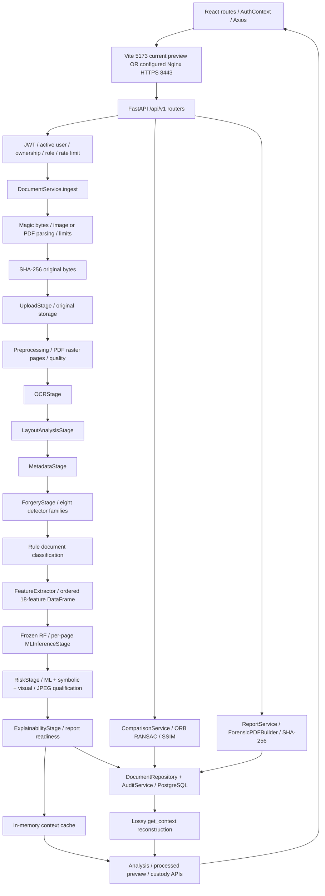

# Actual architecture and lifecycle

Source-led inspection, 13 November 2026. Phase one is read-only except these deliverables.

Composition root: `backend/app/__init__.py`. Sequential registered stages are the actual processing path. `EvidenceFusionStage` is imported but unregistered and exposes `process`, unlike the active `run` contract. The older `detectors` package, `evidence_fusion`, evaluation/report scaffolding and `api/endpoints/reports.py` mock route must not be confused with the registered pipeline.

| Boundary | Data-loss or interpretation risk |
|---|---|
| Stream -> bytes | Entire upload read before byte limit |
| Filename -> disk | Sanitization/UUID names present; check-before-write race |
| PDF -> raster | Generated error graphics enter inference; faulty giant-page cap; resource cleanup incomplete |
| Original -> preprocessing | Contrast/deskew/denoise can alter forensic measurements; transform provenance not persisted |
| Detector -> context | Internal exceptions often logged and skipped; no complete module execution ledger |
| Context -> features | Authentic-median imputation; per-page metric indexing vulnerable to skipped images |
| RF -> synthesis | Max-page heuristic and JPEG qualification rewrite raw decisions; composite is not calibrated probability |
| Context -> DB | Multiple commits, swallowed errors, incomplete context schema |
| DB -> context | Missing per-page/quality/metadata/visual/compression/raw-vector fields; unified tier substituted for ML tier |
| API -> UI | Genuine results mixed with hardcoded module states and medians |
| Context -> report | Wrong score key, fixed version, invalid fallback region fields |
| Lifecycle -> custody | Append-only triggers exist, but independent commits do not ensure atomic ingestion |

Inventory: 242 backend application Python files (~19,233 lines), 27 test files (~6,448 lines), four migration revisions, 20 tools and 48 frontend TS/TSX files (~7,920 lines). File hashes and route declarations are in `baseline_manifest.json`. No Git repository metadata exists at the root; preserve the manifest and explicit change log.

Read-only evidence: native database runtime role, table inventory/grants/triggers/counts, trusted hash-verified model structure. Current local Vite/Uvicorn/native PostgreSQL preview is not evidence of a working Docker HTTPS deployment.
