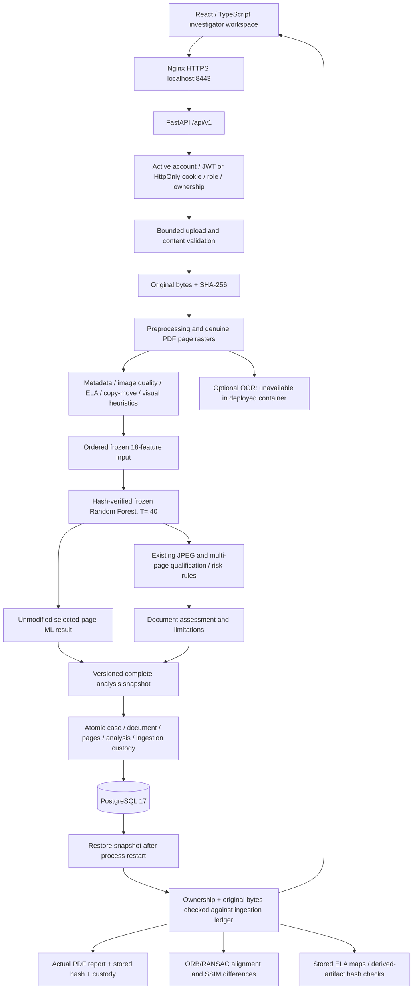

# Final architecture

13 November 2026. This describes the registered application after stabilization. The initial audit files remain unchanged as the investigation baseline.

The pilot uses three persistent containers. Only Nginx ports 8080 and 8443 bind to 127.0.0.1. Backend and PostgreSQL have no host mappings. A separate native development setup remains available on 5173/8000 with its existing native database on 5433; its data is separate from the pilot database.

Composition root: `backend/app/__init__.py`. Actual ML inference lives under `app/services/ml_inference`; active risk synthesis remains `RiskStage`. Imported, unregistered experimental fusion/evaluation/report scaffolding is not the runtime implementation. Fabricated outputs from those legacy entry points now fail explicitly.

`analyses.context_snapshot` is nullable, versioned JSON. New analyses retain real feature vectors, raw and per-page inference, metadata, quality, artifacts, warnings and execution states. Historical rows are not backfilled. Legacy missing information is displayed as unavailable. Snapshot identity does not overwrite document identity or original bytes.

Original files are preserved on disk; ingestion database work commits once. Persistence failure returns an error and never caches a successful result. Retained orphaned files may require controlled recovery; filesystem writes and PostgreSQL cannot form a single distributed transaction.

Evidence retrieval requires the earliest EXHIBIT_INGESTED digest from the append-only ledger. Missing originals return 410; unverifiable or changed originals return 409 and a real custody event. Original download, preview, analysis, heatmap and report generation remain authenticated and scoped. Derived rasters are previews, not replacements for originals.

See [deployment guide](deployment_and_demo_guide.md), [final security report](final_security_report.md), and [known limitations](known_limitations.md).
